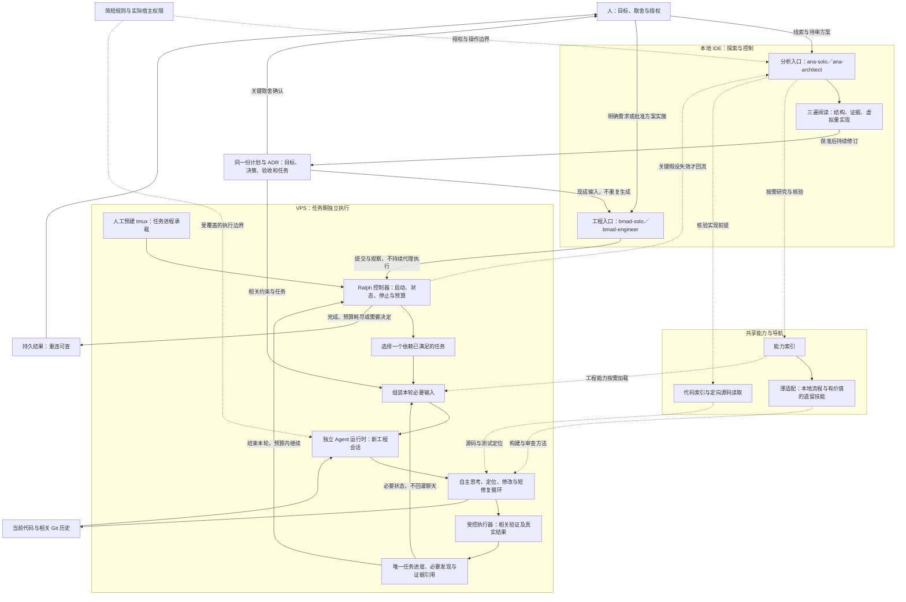
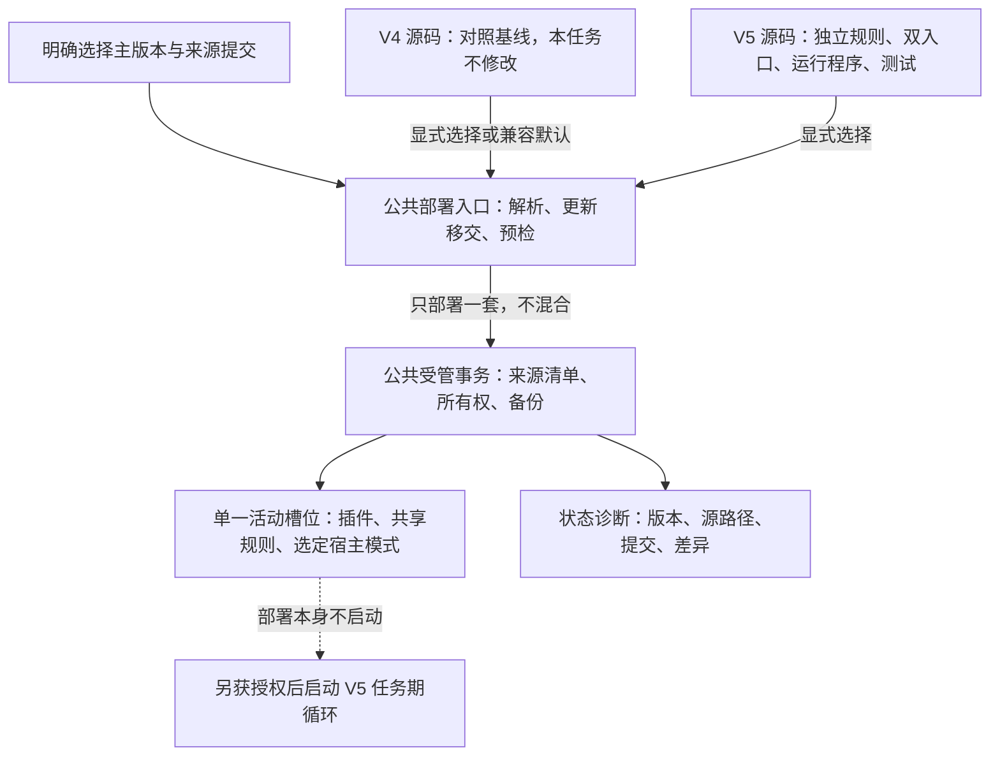

# ADR-20261012：BMRalph V5 独立套件、双入口减负与远程自主执行

- Status: PROPOSED
- 创建日期：2026-10-12；本次修订：2026-10-16。
- 授权范围：2026-10-16 用户授权 Phase 1 本地工程套件与反例封顶闭环并执行 Git 提交固化：已验收 Epic 7、2、4 的本地原语，补齐 Epic 3 受控回滚及孤儿进程/中断反例并通过全量 238 项单测及契约回归。后续 Phase 2 交接由 Roo Code 在目标环境（VPS / 独立会话）接管实施 Epic 5 任务期 Ralph 循环。新生产实现独立放入 V5，保留 V4 对照源码和用户既有改动。提交推送至远端、生产部署、ADR 转正和计划归档仍须另获授权，不在 ADR 镜像当前进度。
- 会话标识：null；不编造历史或当前会话标识。
- 实施计划：[本任务计划](../pending_implementation_plan.md)，计划标识 BMAD-ANTI-BUREAUCRACY-20261012-01；保留同一契约和全部未完成事项，不在 ADR 镜像任务进度。
- 演进来源：[执行性能与门禁简化提案](ADR-20261011-bmad-solo-execution-performance-and-gate-simplification.md:23)。本次保持同一任务与原未完成事项，不新建镜像方案。
- 证据边界：设计依据来自客户端返回的仓库文件、用户提供的参考笔记与需求；下文此前“本次只结晶”“尚未创建”“未运行”描述 2026-10-15 设计基线，不是当前实施禁令或验证结论。实施证据由当前平台任务记录引用真实工具回执，静态检查和本地模拟不证明目标运行时或远程断开行为。

## 1. 上下文与业务驱动 (Context & Business Driver)

目标是在保持编码质量与真实验证的同时，减少重复分析、状态镜像、历史回灌和无意义审批。先删除不必要的工作，再由薄程序承担剩余机械工作，而不是把繁复账本自动化。

- 用户要求保留分析入口的三遍阅读、探索、审计及目标固化；工程入口消费明确需求和现成方案，不取代分析入口。
- 用户希望通过本地 Antigravity IDE 的远程连接提交任务后，关闭客户端，VPS 仍能自主思考、编码、验证并启动下一轮。
- [现行工程规则](../../bmad-suite-v4/roo/rules-bmad-engineer/01-bmad-engineer-core.md:17)已经要求状态单源、取消流水镜像和历史全文回灌；这不证明所有下层流程或宿主加载均已一致。
- 此前客户端返回的外部 Ralph 参考仓库实现每轮调用编码工具，外层依据模型输出中的完成标记退出，没有独立执行测试来裁决完成。该观察仅描述已读参考实现，不证明目标 VPS 的运行时能力；不将本项目的静态契约校验器误作 Ralph 源码证据。
- [参考笔记](../../docs/Ralph-Wiggum-Loop/Ralph-Wiggum-Loop.md:369)中的无头接口、桥接方法与性能数字仅为研究线索。历史回答中未附实际来源回执的 Roo CLI 发布或归档断言不纳入已验证事实。
- 用户报告的超大输入、断流及“1 小时缩短到 20 分钟”保留为症状与效果线索；本次未获得对照测量，不能确定因果或承诺固定提速。
- 本轮用户要求为避免与 V4 混淆、便于审核，将优化版本独立放入 [bmralph-suite-v5](../../bmralph-suite-v5/)，并考虑 [bs.sh](../../bs.sh) 更新；保持同一提案与计划，不另建任务或丢失原未完成事项。
- 已读取的 [部署入口](../../bs.sh:23)默认 V4，主分支部署路径也固定 V4；[标签缓存](../../scripts/tag-cache.py:38)、[缓存来源核验](../../scripts/deployment_provenance.py:89)及[静态校验器](../../scripts/validate-roo-contracts.py:41)同样硬编码 V4。只新增目录或参数不足以接通版本选择全链路。
- [受管源映射](../../scripts/deployment_source.py:75)把不同套件部署到同一活动插件槽位及共享规则目标，模式配置也合并到宿主目标。独立源码目录不是同根双活、权限隔离或宿主实际加载的证据。

可行性裁决：方法论减负及小任务闭环可推进设计；客户端关闭后的执行须先证明目标独立运行时可用，属于条件可行，不声称已实现。

## 2. 完整目标架构

下图保留上一方案的全部层次；Ralph 仅补充工程执行生命周期。该目标架构独立落入 [V5 套件](../../bmralph-suite-v5/)，不改写 [V4 套件](../../bmad-suite-v4/) 对照基线。所有新增程序连接均为拟议能力，入口名称和模式标识先保留兼容，不代表已部署或已加载。



## 3. 决策与职责

### 决策 1：双入口保留，交接减薄

- 拟建 [V5 分析入口](../../bmralph-suite-v5/skills/ana-solo/SKILL.md)保留三遍阅读、探索、审计和人机目标收敛；不写生产代码、不使用终端、不把可行裁决当作实施授权。
- 拟建 [V5 工程入口](../../bmralph-suite-v5/skills/bmad/SKILL.md)消费明确需求与已结晶方案；小修复不强制完整分析、ADR 或角色会议。
- 共享拟建 [V5 能力索引](../../bmralph-suite-v5/skills/bmad/references/capability-map.md)，明确本地流程、技能注册与运行依赖的区别；先接通高价值能力，不整库加载。V4 仅作只读参照，必要运行资产纳入 V5，不以跨版本引用替代自包含。
- 代码索引只导航，源码仍须按需核验；失效时定向搜索，不启动来源公证或全项目扫描。
- 普通测试失败进入短修复循环；目标、关键假设或重要接口变更才回到分析侧。

### 决策 2：方案可迭代，承诺不能悄悄改写

- 获准结晶后持续修订同一计划与提案 ADR，避免另建重复过程文档。
- 实施开始稳定的是目标、关键决策及验收边界，不是文件字节。任务拆分、顺序、落点和必要发现可以正常演进。
- 目标扩大、验收放宽、关键决策变化及生产操作须明确授权；只暂停受影响部分。
- 拟将计划任务清单作为任务进度唯一载体；状态卡只是程序生成的有界视图，不另建人工总账。ADR 不记录任务进度，回执不复制到计划。
- 模型勾选不能产生通过事实；执行程序依据真实结果核验任务完成。实际权限隔离未验证时，不宣称文件或回执不可篡改。
- 本决策在 V5 中采用不同于 [V4 状态职责](../../bmad-suite-v4/roo/rules-bmad-engineer/01-bmad-engineer-core.md:17)的设计，须同步 V5 入口、模板与显式版本校验器；当前尚未生效，不为此改写 V4 规则或继承其验证结果。

### 决策 3：文档保存与上下文摄入分开

- 保存目标、决策、导航、任务状态和必要证据，不默认生成探索过程报告。
- 完整日志、历史与临时脚本可按用途保留，但不默认进入下一轮，不顺带清理用户资产。
- 输入只组装当前任务、相关约束、必要能力与索引、当前代码和最近有效反馈；启动输入与累计工具结果均设预算。
- Token 可计数时使用 Token，否则披露字节近似；80 行状态视图不是整个请求的预算。宿主自动加载内容也应观察。
- 超限明确标注并保留证据定位；受控输入不得挤掉关键约束。原生附件与未覆盖工具旁路不称已被阻断。
- 新会话不自动恢复旧聊天，但保留未完成修改；分析三遍阅读不每遍重开窗口，在目标或预算边界交接。

### 决策 4：远程 Ralph 是任务期执行程序，不是新人格

- 本地 IDE 是目标固化和任务控制台；收到远程启动回执后，下一轮的模型、工具、认证和状态保存均不得依赖本地客户端。
- 优先评估独立 Roo 运行时，目标版本、来源、无头接口、自定义模式、模型认证、等待/取消和工具权限均须重新验证。无能力证据时报告具体阻塞，不静默换引擎。
- tmux 只承载远程任务进程；存活不证明 Agent 工作，也不保证机器重启或宿主崩溃恢复。
- GUI 自动续聊或桥接只有证明断开后完整链路可用才可选；未识别的 Antigravity Ralph 插件不作为已可用依赖。
- Ralph 控制器只选任务、组装输入、启动/停止和管理预算；独立 Agent 自主搜索、思考、修改并解释失败。
- 每轮一个可验证任务，会话内允许短修复循环；下一轮根据真实状态继续同一任务或选择下一项。
- Git 保存提交及相关历史，工作区保留未提交成果；不全文读取历史、不提交全部用户改动。自动提交、推送与部署分别授权。

### 决策 5：真实反馈与适度程序防护

- 拟建 [V5 验证执行器](../../bmralph-suite-v5/scripts/bmad-exec.py)负责类型化操作、实际退出结果、命中/跳过判定、超时、取消和日志预算；目前尚未创建。套件位置与任务工作区分开解析，日志、回执和任务成果不写入套件分发源。
- 拟建 [V5 循环入口](../../bmralph-suite-v5/scripts/bmad-loop.py)复用验证执行器，只提供任务启动、状态和停止，不建设永久服务或复杂 IPC 总线；目前尚未创建。安装与受管部署不启动循环；活动任务绑定核验过的套件来源，更新或版本回切前须停止并确认在途进程结束，不在运行中替换规则和程序。
- 完成口令、文件变化、日志写入成功或 Agent 退出均不能单独证明业务完成。
- 测试失败不推进任务，但可在预算内自主修复；网络/模型短暂故障与代码失败分别处理。权限或认证不足、费用/时间/轮次耗尽和持续无进展明确停止。
- 一个工作区一个活动写入者，取消须确认在途进程结束。生产同机采用独立编码工作区、受限账号和验证环境；分支不是系统权限隔离。
- 保留 L0 环境一次准备、L1 相关批次验证、L2 已批准范围的阶段检查；不每轮安装依赖或执行全量回归。
- 相关实现、测试或环境变化后重验受影响结果；无关文档及状态保存不触发业务重测，不用无限补证代替交付。

### 决策 6：局部交付和效果测量

- 阶段或本地范围可以交付，清楚区分已验证内容与未覆盖范围；必要验证失败不能包装为完成。
- 经明确范围调整的非适用项不再阻塞本次交付；不能通过模型自行改目标过关。
- 局部交付不自动标记全计划完成或转正 ADR。新增完成状态先与现行校验器适配，不把新枚举当作现有能力。
- 测量总耗时、所有轮次 Token/费用、重复读取与测试、人工中断和缺陷；新会话的重复初始化成本也计入，不承诺固定三倍提速。

### 决策 7：V5 独立源码，部署选择全链路一致

- 用户指定的 [bmralph-suite-v5](../../bmralph-suite-v5/) 是新套件唯一生产源码根目录，容纳插件描述、规则、模式、双入口、引用、运行程序与专属测试。按需物理继承 V4 必要资产后独立演进，不复制整个历史过程、不使用软链接、不运行时回指 V4。现有 [V4 套件](../../bmad-suite-v4/) 在本任务中不修改；这不是整个仓库已冻结或洁净的声明。
- 根目录的 [部署入口](../../bs.sh)、[安装入口](../../install.sh)及[公共部署脚本](../../scripts/)只做跨版本兼容扩展，继续复用受管所有权、备份、预检与事务机制，不复制第二套部署框架。V5 运行与专属测试放入 V5，公共部署回归留在[现有测试目录](../../tests/roo_distribution/)。现有计划与 ADR 保留原路径、标识及未完成事项，不另建镜像。
- 主分支更新、标签提交选择和套件选择是不同维度。有效版本意图必须穿过参数解析、新版入口移交、源码选择、缓存、来源清单、状态诊断及安装入口；不得更新后又部署其他版本。未指定版本的新安装兼容默认暂保留 V4，首次启用 V5 要显式选择；已有安装执行无版本更新时，保留受管来源记录中已核验的激活版本，在更新或切换主分支前确定并传递该意图。记录缺失、损坏或无法唯一判断时阻塞并要求显式选择，不按默认回切 V4。默认切换是另外的决定，不由新目录或主分支更新隐式触发。多个不同版本、标签契约冲突或选定源缺失均停止，不静默回退。
- 标签缓存以实际提交与套件身份联合核验；同一提交内 V4/V5 不误复用。旧 V4 缓存保留兼容，V5 采用独立缓存命名空间；不自动改写旧标记或接管损坏缓存。标签名仅提供线索，最终核验提交中的目录与身份，不把 V4 标签内容当作 V5。
- 来源清单拟增加套件身份、主版本及仓库内源路径，状态输出还保留提交与源差异信息；不把仓库提交号、默认参数或当前 HEAD 当作已部署架构版本。新增 schema 与旧清单兼容须由工程实现；旧记录不能唯一判断版本时明确报告未知，不为展示而伪造元数据。
- 首轮建议保留单一活动插件槽位和现有模式标识，以减少迁移变量；展示名称和来源元数据必须明确 V5。同一部署根只激活一套共享规则，另建插件目录不能解决全局规则和模式冲突，因此不建设同根双活。V5 试用先用显式临时部署根；独立宿主配置、实际加载与权限仍须验证。
- V4→V5→V4 回切通过受管事务处理，只退役所有权确认且未被用户修改的资产，保留第三方配置、用户改动、备份和未完成恢复证据，不删除整个插件或规则目录。源码版本存在不等于已部署回切，更不等于宿主加载完成。
- 已有部署的版本操作复用同一固定部署锁，不另建第二套锁框架：[公共版本守卫](../../scripts/deployment-version-guard.py)须在仓库更新、分支切换或标签缓存准备前获取排他锁，跨新版入口移交持续持有；最终受管部署仅借用经 Linux 内核锁记录核验的描述符，不释放外层锁。环境标记和描述符编号不能替代持锁证据；已有部署缺失锁时失败关闭，不补造锁，只读版本预览不获取写锁。此协议仅约束针对同一部署根、遵循公共入口的操作，不保证跨部署根的共享来源冻结或同账号恶意写入隔离；活动任务仍须绑定已核验来源，并在全部在途进程结束后释放读取租约。对应验收契约见[计划验证矩阵](../pending_implementation_plan.md:148)，不以局部互斥替代完整任务期循环与取消门禁。
- 活动任务来源绑定采用[V5 来源绑定模块](../../bmralph-suite-v5/scripts/bmad_suite_source.py)与[共享读取租约](../../bmralph-suite-v5/scripts/bmad_suite_lease.py)组合：先持有现有部署锁，再核验明确的 V5 身份、受管物理文件、来源摘要及分发映射；接管、契约变化和阶段边界发现变化时停止对账，不补造来源、不恢复旧文件、不覆盖用户修改。只读取部署根，不访问记录中的来源仓库；部署时提交记录不证明当前 HEAD 或远程版本。该一致性机制不保证同账号防篡改，不替代宿主模式语义、事务完成诊断、运行时加载或权限核验；任务期调用方仍须接入并确认全部在途进程结束后才释放租约，不能以原语存在或局部测试代替循环与取消门禁。
- 静态校验按显式套件选择分别检查各版本自己的规则、模板和模式，验收命令以[计划验证矩阵](../pending_implementation_plan.md:136)为准；V4 通过不得替代 V5 验收，静态检查不证明运行时权限或远程行为。未实现的运行操作不得编造子命令。

版本与执行边界如下，均为目标设计：



## 4. 备选方案裁决

| 候选 | 裁决 | 原因 |
|---|---|---|
| 继续增加提示词警告或角色会议 | 否决 | 不解决重复工作和运行生命周期，增加上下文与审批成本 |
| 用脚本加速原多文档账本 | 否决 | 仍需维护重复信息，状态保存继续产生额外验证 |
| 只延长网关超时或切换模型 | 不作为本任务方案 | 未证明网络因果，不能替代工作和输入减负 |
| 永久调度平台、复杂多智能体与记忆数据库 | 否决首轮建设 | 先接通一个小任务闭环，再按实际缺口扩展 |
| 完全冻结计划或无条件覆盖活动入口 | 否决 | 前者制造桥接文档，后者可能丢失未完成任务 |
| 直接搬运 Ralph 提示词与完成口令 | 否决 | 不能替代真实验证，全文进度日志会重新膨胀 |
| IDE 面板自动化作为断开后的运行依据 | 不满足当前硬门禁 | 除非证明远程运行时独立；不能只证明点击成功 |
| 独立运行时＋薄循环＋受控验证 | 条件采用 | 须核验目标引擎与远程断开能力；保留双入口和自主思考 |

## 5. 历史不变量、修订关系与非目标

- 保留[已接受生命周期 ADR](ADR-20261008-roocode-bmad-v42-lifecycle-and-governance.md:37)中的显式任务优先、历史恢复授权、分析权限、第三方资产保护与真实证据边界。
- 拟细化该 ADR 第 4 节：新需求不默认搜索历史归档；归档发现仅适用于明确的继续/恢复意图。已有未完成活动任务不被自动覆盖。
- 拟在 V5 演进该 ADR 第 5、7 节有关工程执行与状态职责：任务清单作为唯一进度、受监督的任务期进程作为执行增强、只有受影响证据才重验。提案接受与相关实现前，不宣称替代条款已经生效；不修改 V4 对照规则或原历史接受范围。
- 不修改已接受 ADR 或其项目事实记录；不把历史任务的通过状态继承到新任务。
- 受管部署的所有权、备份、事务保护和低频防覆盖仍保留，取消日常微步指纹不适用于删除这些安全机制。
- 非目标：不修改 V4 对照源码或已接受 ADR，不覆盖用户既有改动；不建设永久平台，不改变网关，不执行真实宿主激活、远程任务、自动提交、推送、发布、转正或归档，不保证所有版本兼容或自动崩溃恢复。项目事实仅登记通过对应门禁的已验证内容，不登记提案或模拟结果为运行时事实。

## 6. 最小充分验收与失败模式

原环境复用、取消微步对账、有界结果、真实失败和受控回滚要求继续保留；具体阶段与资产状态以[本任务计划](../pending_implementation_plan.md)为准，不在 ADR 镜像进度。

首轮远程验证只聚焦三组：

1. 客户端关闭后：远程 Agent 完成当前步骤并自主启动下一轮，而非仅 tmux 或循环进程存活。
2. 新会话必要记忆：不恢复完整聊天，相关约束、未提交成果、未完成任务和有效失败反馈仍可使用；累计输入/输出预算真实生效。
3. 真实失败与有界停止：测试失败、不命中必需测试、Agent 退出异常和取消均不得产生假通过；预算内可修复，停止后成果和必要结果可查。

最关键的失败模式及应对：

- 运行时仍依赖本地宿主：在首个能力试跑淘汰，不先建设 GUI 桥接。
- 新会话每轮灌入全部规则和历史：预算覆盖受控输入与工具累计输出，相关材料按需加载。
- 模型写通过状态或文件变化提前触发下一轮：等待实际执行结束并以真实验证结果裁决，取消确认在途进程结束。
- 失败修改与用户改动被自动回滚或提交：独立工作区、单写入者和明确提交范围；不执行全目录恢复。

## 7. 拟执行验证与实施顺序

设计阶段保留的静态命令如下；是否通过以工程阶段真实回执为准，不能从命令列举推断执行：

```bash
timeout 30s python3 scripts/validate-roo-contracts.py --plan _bmad-output/pending_implementation_plan.md < /dev/null
```

[现有校验器](../../scripts/validate-roo-contracts.py:41)已读取，只检验 V4 配置与计划元数据形状，不执行计划命令，也不验证尚未创建的 V5 或运行时能力。上方命令仅为当前可用的 V4 静态检查；工程阶段实现显式套件接口后须同步计划头部和 V5 验证矩阵。V5 验证执行器、循环入口与专属测试尚未创建；版本分发兼容用例、确切命令及远程试跑前提见计划。

最小落地顺序：V5 最小目录与显式版本选择／校验 → V5 规则与状态职责对齐 → 独立运行时能力试跑 → 一个新会话任务的真实验证闭环 → 两轮必要记忆及断开客户端验收 → 有界无人值守与效果测量。部署兼容回归随公共入口改动执行，不把完整部署平台、整库接入、全控制器或全排列矩阵变成前置条件。

## 8. 未决条件与交付状态

- 目标 Roo 独立运行时的来源、版本、命令与认证待核验；具体 Antigravity Ralph 插件未识别。
- 任务预算、工作区、提交权限及远程试跑范围在工程接管时明确；IDE 登录态不默认可供独立运行时继承。
- V5 套件尚未创建，公共部署与安装入口尚未修改；版本参数、缓存命名、清单 schema 及目标运行接口均未实证。默认保留 V4、单一活动槽位是保守兼容提案，不等于用户已授权真实宿主迁移。
- 当前用户已授权同一计划的项目内工程实施、本地相关验证及必要契约修订；真实宿主迁移、远程启动及预算仍须另获授权。此前未完成事项保留，缺必需证据不得推进受影响阶段。
- 保持 PROPOSED。契约修订和阶段交付不是全计划完工；只有全部必需门禁通过且转正获准时才接受本提案，缺必需运行时证据时不转正、不归档。
