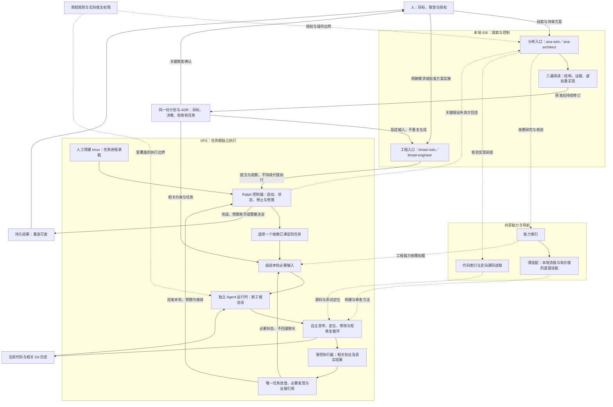
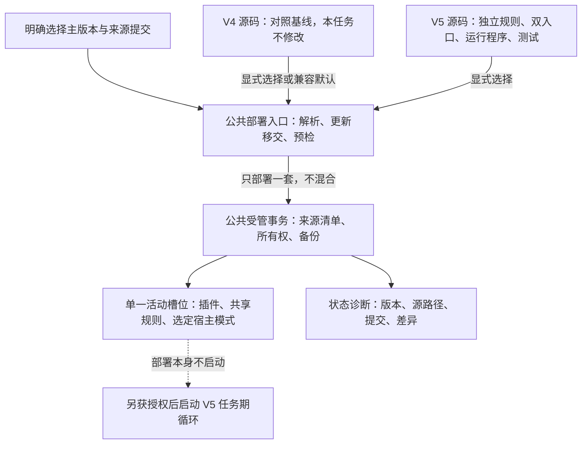

# ADR-20261012：BMRalph V5 独立套件、双入口减负与远程自主执行

- Status: PROPOSED
- 创建日期：2026-10-12；本次修订：2026-10-17。
- 当前授权范围：工程入口继续同一计划进行本地证据接管，持续修订本提案和关联计划；保护已实现后端与新增 Pi 测试，仅允许必要修复[现有后端](../../bmralph-suite-v5/scripts/bmad_agent_backend.py:81)及补齐[Pi 协议反例](../../bmralph-suite-v5/tests/test_pi_backend.py:1)，允许一个受限对账草稿和追加 Phase 5 回执。六项旧完成任务完整沿用原验证对象定向重验，经程序一次刷新；P5-PI-DRIVER 仅获准在既有写租约及源版本保护下行政恢复为 PENDING/空回执，再凭匹配本地证据程序登记。P5-PI-HEADLESS 保持 SUSPENDED/空回执。循环、入口、状态、适配、执行及既有测试原语冻结，V4 只读；不重装或更新 Pi、不准备认证、不读取凭据正文、不真实模型调用、不宿主激活、不远程或客户端断开试跑、不提交、推送、部署、转正或归档，不提高预算。该授权不等于验收通过或真实运行授权。
- 会话标识：null；不编造历史或当前会话标识。
- 实施计划：[本任务计划](../pending_implementation_plan.md)，计划标识 BMAD-ANTI-BUREAUCRACY-20261012-01；保留同一契约和全部未完成事项，不在 ADR 镜像任务进度。
- 演进来源：[执行性能与门禁简化提案](ADR-20261011-bmad-solo-execution-performance-and-gate-simplification.md:23)。本次保持同一任务与原未完成事项，不新建镜像方案。
- 证据边界：设计依据来自客户端返回的仓库文件、用户提供的参考笔记与需求；下文此前“本次只结晶”“尚未创建”“未运行”描述 2026-10-15 设计基线，不是当前实施禁令或验证结论。实施证据由当前平台任务记录引用真实工具回执，静态检查和本地模拟不证明目标运行时或远程断开行为。

## 1. 上下文与业务驱动 (Context & Business Driver)

目标是在保持编码质量与真实验证的同时，减少重复分析、状态镜像、历史回灌和无意义审批。先删除不必要的工作，再由薄程序承担剩余机械工作，而不是把繁复账本自动化。

- 用户要求保留分析入口的三遍阅读、探索、审计及目标固化；工程入口消费明确需求和现成方案，不取代分析入口。
- 用户希望通过本地 Antigravity IDE 的远程连接提交任务后，关闭客户端，VPS 仍能自主思考、编码、验证并启动下一轮。
- [现行工程规则](../../bmad-suite-v4/roo/rules-bmad-engineer/01-bmad-engineer-core.md:17)已经要求状态单源、取消流水镜像和历史全文回灌；这不证明所有下层流程或宿主加载均已一致。
- 此前客户端返回的外部 Ralph 参考仓库实现每轮调用编码工具，外层依据模型输出中的完成标记退出，没有独立执行测试来裁决完成。该观察仅描述已读参考实现，不证明目标 VPS 的运行时能力；不将本项目的静态契约校验器误作 Ralph 源码证据。
- [参考笔记](../../docs/Ralph-Wiggum-Loop/Ralph-Wiggum-Loop.md:369)中的无头接口、桥接方法与性能数字仅为研究线索。历史回答中未附实际来源回执的 Roo CLI 发布或归档断言不纳入已验证事实。
- 用户报告的超大输入、断流及“1 小时缩短到 20 分钟”保留为症状与效果线索；本次未获得对照测量，不能确定因果或承诺固定提速。
- 本轮用户要求为避免与 V4 混淆、便于审核，将优化版本独立放入 [bmralph-suite-v5](../../bmralph-suite-v5/)，并考虑 [bs.sh](../../bs.sh) 更新；保持同一提案与计划，不另建任务或丢失原未完成事项。
- 已读取的 [部署入口](../../bs.sh:23)默认 V4，主分支部署路径也固定 V4；[标签缓存](../../scripts/tag-cache.py:38)、[缓存来源核验](../../scripts/deployment_provenance.py:89)及[静态校验器](../../scripts/validate-roo-contracts.py:41)同样硬编码 V4。只新增目录或参数不足以接通版本选择全链路。
- [受管源映射](../../scripts/deployment_source.py:75)把不同套件部署到同一活动插件槽位及共享规则目标，模式配置也合并到宿主目标。独立源码目录不是同根双活、权限隔离或宿主实际加载的证据。

可行性裁决：方法论减负及小任务闭环可推进设计；客户端关闭后的执行须先证明目标独立运行时可用，属于条件可行，不声称已实现。

## 2. 完整目标架构

下图保留上一方案的全部层次；Ralph 仅补充工程执行生命周期。该目标架构独立落入 [V5 套件](../../bmralph-suite-v5/)，不改写 [V4 套件](../../bmad-suite-v4/) 对照基线。所有新增程序连接均为拟议能力，入口名称和模式标识先保留兼容，不代表已部署或已加载。



## 3. 决策与职责

### 决策 1：双入口保留，交接减薄

- 拟建 [V5 分析入口](../../bmralph-suite-v5/skills/ana-solo/SKILL.md)保留三遍阅读、探索、审计和人机目标收敛；不写生产代码、不使用终端、不把可行裁决当作实施授权。
- 拟建 [V5 工程入口](../../bmralph-suite-v5/skills/bmad/SKILL.md)消费明确需求与已结晶方案；小修复不强制完整分析、ADR 或角色会议。
- 共享拟建 [V5 能力索引](../../bmralph-suite-v5/skills/bmad/references/capability-map.md)，明确本地流程、技能注册与运行依赖的区别；先接通高价值能力，不整库加载。V4 仅作只读参照，必要运行资产纳入 V5，不以跨版本引用替代自包含。
- 代码索引只导航，源码仍须按需核验；失效时定向搜索，不启动来源公证或全项目扫描。
- 普通测试失败进入短修复循环；目标、关键假设或重要接口变更才回到分析侧。

### 决策 2：方案可迭代，承诺不能悄悄改写

- 获准结晶后持续修订同一计划与提案 ADR，避免另建重复过程文档。
- 实施开始稳定的是目标、关键决策及验收边界，不是文件字节。任务拆分、顺序、落点和必要发现可以正常演进。
- 目标扩大、验收放宽、关键决策变化及生产操作须明确授权；只暂停受影响部分。
- 拟将计划任务清单作为任务进度唯一载体；状态卡只是程序生成的有界视图，不另建人工总账。ADR 不记录任务进度，回执不复制到计划。
- 模型勾选不能产生通过事实；执行程序依据真实结果核验任务完成。实际权限隔离未验证时，不宣称文件或回执不可篡改。
- 本决策在 V5 中采用不同于 [V4 状态职责](../../bmad-suite-v4/roo/rules-bmad-engineer/01-bmad-engineer-core.md:17)的设计，须同步 V5 入口、模板与显式版本校验器；当前尚未生效，不为此改写 V4 规则或继承其验证结果。

### 决策 3：文档保存与上下文摄入分开

- 保存目标、决策、导航、任务状态和必要证据，不默认生成探索过程报告。
- 完整日志、历史与临时脚本可按用途保留，但不默认进入下一轮，不顺带清理用户资产。
- 输入只组装当前任务、相关约束、必要能力与索引、当前代码和最近有效反馈；启动输入与累计工具结果均设预算。
- Token 可计数时使用 Token，否则披露字节近似；80 行状态视图不是整个请求的预算。宿主自动加载内容也应观察。
- 超限明确标注并保留证据定位；受控输入不得挤掉关键约束。原生附件与未覆盖工具旁路不称已被阻断。
- 新会话不自动恢复旧聊天，但保留未完成修改；分析三遍阅读不每遍重开窗口，在目标或预算边界交接。

### 决策 4：远程 Ralph 是任务期执行程序，不是新人格

- 本地 IDE 是目标固化和任务控制台；收到远程启动回执后，下一轮的模型、工具、认证和状态保存均不得依赖本地客户端。
- 运行时条件优先候选变更为 Pi Coding Agent；Claude Code 保留为待核验的兼容候选，Roo CLI 不再作为新增适配对象。替代范围、证据及淘汰规则见下方决策 8；任何候选的目标安装、固定版本、新会话、规则加载、独立认证、工具权限和清理仍须实际核验，选型不等于运行授权。
- tmux 只承载远程任务进程；存活不证明 Agent 工作，也不保证机器重启或宿主崩溃恢复。
- 不建设 GUI 自动点击、自动续聊或宿主登录态桥接；Antigravity IDE 承载目标收敛与方法论入口，VPS 独立进程承载工程执行。未识别的 IDE 插件不作为运行依赖，方法论兼容不能代替实际规则与权限加载证据。
- Ralph 控制器只选任务、组装输入、启动/停止和管理预算；独立 Agent 自主搜索、思考、修改并解释失败。
- 每轮一个可验证任务，会话内允许短修复循环；下一轮根据真实状态继续同一任务或选择下一项。
- Git 保存提交及相关历史，工作区保留未提交成果；不全文读取历史、不提交全部用户改动。自动提交、推送与部署分别授权。

### 决策 5：真实反馈与适度程序防护

- 拟建 [V5 验证执行器](../../bmralph-suite-v5/scripts/bmad-exec.py)负责类型化操作、实际退出结果、命中/跳过判定、超时、取消和日志预算；目前尚未创建。套件位置与任务工作区分开解析，日志、回执和任务成果不写入套件分发源。
- 拟建 [V5 循环入口](../../bmralph-suite-v5/scripts/bmad-loop.py)复用验证执行器，只提供任务启动、状态和停止，不建设永久服务或复杂 IPC 总线；目前尚未创建。安装与受管部署不启动循环；活动任务绑定核验过的套件来源，更新或版本回切前须停止并确认在途进程结束，不在运行中替换规则和程序。
- 完成口令、文件变化、日志写入成功或 Agent 退出均不能单独证明业务完成。
- 测试失败不推进任务，但可在预算内自主修复；网络/模型短暂故障与代码失败分别处理。权限或认证不足、费用/时间/轮次耗尽和持续无进展明确停止。
- 一个工作区一个活动写入者，取消须确认在途进程结束。生产同机采用独立编码工作区、受限账号和验证环境；分支不是系统权限隔离。
- 保留 L0 环境一次准备、L1 相关批次验证、L2 已批准范围的阶段检查；不每轮安装依赖或执行全量回归。
- 相关实现、测试或环境变化后重验受影响结果；无关文档及状态保存不触发业务重测，不用无限补证代替交付。
- 同一计划的下一批本地实现采用显式获准任务集合，不把全计划散文或所有就绪项视为无限执行授权。程序以独立验证裁决当前任务，失败时在预算内以新会话接收真实反馈继续修复；通过并保存后自动选择集合内下一依赖就绪任务，不要求用户逐任务再次启动。各任务必要输入独立，失败反馈不得错误归属其他任务。
- 分离单次模型请求、工具执行、Agent 会话及批次预算。既有驱动进程上限仍为 30 秒，工具分级为 15/30/600 秒、批次上限为 600 秒；这些上限不证明 Pi 或 Claude Code 内部单请求、工具调用、重试和费用受到同等约束。本轮不提高上限、不猜参数；无法在现有预算内完成试验时停止并请求明确调整，不能取消门禁或把外层调用次数冒充模型调用次数。
- 运行监督器与待修改源码采用隔离运行副本，并接入既有来源绑定和读取租约；候选源码可以在授权范围内优化，但不得热改当前绑定程序后继续运行。升级顺序为停止、确认全部受管进程清理、验证候选版本、经获准边界启用。清理未知阻断新调用和重启；文件锁释放或同账号隔离目录不证明系统权限隔离。
- Pi 条件优先不表示真实后端门禁已打开；版本声明、官方接口文档和静态分发均不证明本机独立运行成功。真实运行时不得声明为隔离夹具，不得继承 IDE 登录态或静默回退 Roo、Claude Code 或其他引擎；未授权或缺少真实轮次、业务验证和清理证据时不宣称自主执行链路通过。

### 决策 6：局部交付和效果测量

- 阶段或本地范围可以交付，清楚区分已验证内容与未覆盖范围；必要验证失败不能包装为完成。
- 经明确范围调整的非适用项不再阻塞本次交付；不能通过模型自行改目标过关。
- 局部交付不自动标记全计划完成或转正 ADR。新增完成状态先与现行校验器适配，不把新枚举当作现有能力。
- 测量总耗时、所有轮次 Token/费用、重复读取与测试、人工中断和缺陷；新会话的重复初始化成本也计入，不承诺固定三倍提速。

### 决策 7：V5 独立源码，部署选择全链路一致

- 用户指定的 [bmralph-suite-v5](../../bmralph-suite-v5/) 是新套件唯一生产源码根目录，容纳插件描述、规则、模式、双入口、引用、运行程序与专属测试。按需物理继承 V4 必要资产后独立演进，不复制整个历史过程、不使用软链接、不运行时回指 V4。现有 [V4 套件](../../bmad-suite-v4/) 在本任务中不修改；这不是整个仓库已冻结或洁净的声明。
- 根目录的 [部署入口](../../bs.sh)、[安装入口](../../install.sh)及[公共部署脚本](../../scripts/)只做跨版本兼容扩展，继续复用受管所有权、备份、预检与事务机制，不复制第二套部署框架。V5 运行与专属测试放入 V5，公共部署回归留在[现有测试目录](../../tests/roo_distribution/)。现有计划与 ADR 保留原路径、标识及未完成事项，不另建镜像。
- 主分支更新、标签提交选择和套件选择是不同维度。有效版本意图必须穿过参数解析、新版入口移交、源码选择、缓存、来源清单、状态诊断及安装入口；不得更新后又部署其他版本。未指定版本的新安装兼容默认暂保留 V4，首次启用 V5 要显式选择；已有安装执行无版本更新时，保留受管来源记录中已核验的激活版本，在更新或切换主分支前确定并传递该意图。记录缺失、损坏或无法唯一判断时阻塞并要求显式选择，不按默认回切 V4。默认切换是另外的决定，不由新目录或主分支更新隐式触发。多个不同版本、标签契约冲突或选定源缺失均停止，不静默回退。
- 标签缓存以实际提交与套件身份联合核验；同一提交内 V4/V5 不误复用。旧 V4 缓存保留兼容，V5 采用独立缓存命名空间；不自动改写旧标记或接管损坏缓存。标签名仅提供线索，最终核验提交中的目录与身份，不把 V4 标签内容当作 V5。
- 来源清单拟增加套件身份、主版本及仓库内源路径，状态输出还保留提交与源差异信息；不把仓库提交号、默认参数或当前 HEAD 当作已部署架构版本。新增 schema 与旧清单兼容须由工程实现；旧记录不能唯一判断版本时明确报告未知，不为展示而伪造元数据。
- 首轮建议保留单一活动插件槽位和现有模式标识，以减少迁移变量；展示名称和来源元数据必须明确 V5。同一部署根只激活一套共享规则，另建插件目录不能解决全局规则和模式冲突，因此不建设同根双活。V5 试用先用显式临时部署根；独立宿主配置、实际加载与权限仍须验证。
- V4→V5→V4 回切通过受管事务处理，只退役所有权确认且未被用户修改的资产，保留第三方配置、用户改动、备份和未完成恢复证据，不删除整个插件或规则目录。源码版本存在不等于已部署回切，更不等于宿主加载完成。
- 已有部署的版本操作复用同一固定部署锁，不另建第二套锁框架：[公共版本守卫](../../scripts/deployment-version-guard.py)须在仓库更新、分支切换或标签缓存准备前获取排他锁，跨新版入口移交持续持有；最终受管部署仅借用经 Linux 内核锁记录核验的描述符，不释放外层锁。环境标记和描述符编号不能替代持锁证据；已有部署缺失锁时失败关闭，不补造锁，只读版本预览不获取写锁。此协议仅约束针对同一部署根、遵循公共入口的操作，不保证跨部署根的共享来源冻结或同账号恶意写入隔离；活动任务仍须绑定已核验来源，并在全部在途进程结束后释放读取租约。对应验收契约见[计划验证矩阵](../pending_implementation_plan.md:148)，不以局部互斥替代完整任务期循环与取消门禁。
- 活动任务来源绑定采用[V5 来源绑定模块](../../bmralph-suite-v5/scripts/bmad_suite_source.py)与[共享读取租约](../../bmralph-suite-v5/scripts/bmad_suite_lease.py)组合：先持有现有部署锁，再核验明确的 V5 身份、受管物理文件、来源摘要及分发映射；接管、契约变化和阶段边界发现变化时停止对账，不补造来源、不恢复旧文件、不覆盖用户修改。只读取部署根，不访问记录中的来源仓库；部署时提交记录不证明当前 HEAD 或远程版本。该一致性机制不保证同账号防篡改，不替代宿主模式语义、事务完成诊断、运行时加载或权限核验；任务期调用方仍须接入并确认全部在途进程结束后才释放租约，不能以原语存在或局部测试代替循环与取消门禁。
- 静态校验按显式套件选择分别检查各版本自己的规则、模板和模式，验收命令以[计划验证矩阵](../pending_implementation_plan.md:136)为准；V4 通过不得替代 V5 验收，静态检查不证明运行时权限或远程行为。未实现的运行操作不得编造子命令。

版本与执行边界如下，均为目标设计：



### 决策 8：运行时替代关系与条件选型

本节是同一 PROPOSED 提案内的替代条款，不新建 ADR，不改变已有接受决策的历史范围，不镜像任务进度。以下来源编号属于本节的局部引用，不继承此前无实际检索回执的编号。

#### 证据与替代范围

- Roo 官方仓库页面显示仓库已于 2026-05-15 归档、只读；据此淘汰其作为本项目后续演进的优先适配对象，不推导“所有既有安装不能运行”。主机未安装是用户陈述，历史目录空列表不能独立证明该事实。[1]
- Pi 官方编码 Agent 文档将自身描述为极简、可扩展的终端 Agent；RPC 文档明确采用子进程及标准输入/输出 JSONL，适合语言无关集成，SDK 文档另提供进程内 TypeScript 接入。当前这些是上游接口说明，不是目标安装的能力回执。[2][3][8]
- Pi 的统一 LLM 层文档包含提供方、认证、Token 和费用跟踪抽象；这支持模型中立方向，但不证明选定提供方、模型、认证或计费在目标安装可用。[4]
- Claude Code 官方文档提供非交互 CLI、结构化与流式输出、工具授权选项；这支持将其保留为兼容候选，不证明其协议与 Pi 相同，也不证明任意提供方 BYOK 已满足。[5]
- 用户指定的 Pi 旧仓库地址本轮读取后跳转到 earendil-works/pi；安装前必须重新绑定实际上游身份、包名、固定版本或提交和发布产物，不从旧名称猜安装命令。[6]

替代条款：本提案原决策 4、决策 5、未决条件及关联计划 Epic 5 中“优先独立 Roo 运行时”的当前设计假设，由“Pi 条件优先、Claude Code 待核验兼容、无自动回退”替代。Phase 3/4 历史描述、已有测试名称和回执保留，不把历史 Roo 反例重命名为 Pi 验收，不删除既有部署兼容承诺。

#### 决策矩阵与硬门禁

先检查目标技术栈、来源生命周期、实际权限和预算，再比较方法论适配；不以星数、宣传、未经实测的速度或主观加权总分决定。证据等级仅说明证据强度：E0 为尚无充分证据，E1 为官方文档/源码静态证据，E2 为目标安装资产证据，E3 为获准真实运行证据；它不是产品优劣评分。

| 维度 | Roo CLI | Claude Code | Pi Coding Agent |
|---|---|---|---|
| 生命周期门禁 | 官方仓库归档，淘汰新增优先适配；不判定既有资产不可用 [1] | 官方非交互文档可读；固定版本、目标安装与后续支持尚未核验，E1 [5] | 官方仓库及接口文档为 E1；前序接管报告官方 1.3.0 已安装，本轮不重装，安装与版本查询不提升为 E3 [2][6] |
| 模型自由度 / BYOK | 淘汰后不继续补评，不凭增强议题给分 | 当前读取页面不足以证明任意提供方接入，E0；保留兼容候选 [5] | 统一提供方和认证抽象有依据，E1；目标提供方与模型仍须核验 [4] |
| 无头 / RPC | 历史发布线索不是本机可用接口，不继续投入 | 非交互、JSON 与流式接口有文档依据，E1；不称与 Pi RPC 线协议相同 [5] | RPC 与 SDK 为上游静态证据，E1 [3][8]；当前本地方案实际采用后端内固定版本单次 JSON 薄驱动，协议反例不证明目标模型运行 |
| 方法论承载 | 原规则资产保留，不再建设独立 Roo 执行适配 | 官方文档支持工具授权；完整规则装载和输入预算映射尚未验证，E1/E0 [5] | 极简可扩展 harness 与薄控制器方向相符；规则装载、扩展权限及预算仍未实测，E1/E0 [2] |
| 等待、取消、清理、费用 | 不追加取证 | 官方流式结果含会话与成本元数据；强制停止和预算覆盖仍未验证，E1/E0 [5] | 有 RPC 取消命令及用量抽象线索；目标版本取消、进程清理和强制预算仍未验证，E1/E0 [4][7] |
| 目标 VPS 两轮独立运行 | 未通过且停止新增适配 | 未试跑，E0 | 未试跑，E0 |
| 本轮裁决 | 淘汰新增优先适配 | 待核验的协议兼容候选，不自动启用 | 条件优先，不是运行验收通过 |

Pi 胜出的是本轮架构方向：用户要求模型中立，已有提供方抽象及语言无关 RPC 证据，与 Python 薄控制器的分工相符。[3][4] 不宣称 Pi 比 Claude Code 更快、更安全或接口更成熟；实际安装、权限、清理或预算任一硬门禁不满足时停止 Pi 接入，不静默选择第二名。

#### 静态接入矛盾与冻结边界

此前第三遍推演保存为历史设计依据；当前源码落点与授权已变化，静态推演及协议反例仍不算真实 Pi 运行实测：

- [后端加载边界](../../bmralph-suite-v5/scripts/bmad_agent_backend.py:41)已接受真实 Pi 类别，[薄驱动](../../bmralph-suite-v5/scripts/bmad_agent_backend.py:81)位于同一后端模块，固定官方来源、包身份与 1.3.0，并限制启动参数；不新增独立生产驱动，不换引擎或引入变体。
- [循环真实运行门禁](../../bmralph-suite-v5/scripts/bmad_loop.py:353)仍拒绝非夹具，[入口枚举](../../bmralph-suite-v5/scripts/bmad-loop.py:19)仍冻结。因此仅修改后端不能真实接通；本轮不得绕过门禁或把 Pi 标为夹具。
- [任务验证契约](../../bmralph-suite-v5/scripts/bmad_state.py:62)仍仅支持 Python 单测。公共静态检查不裁决完整任务块或运行时能力；完成候选必须经[精确证据核验](../../bmralph-suite-v5/scripts/bmad_state.py:172)，不能用普通查询 PASS 或测试数量替代。

当前方案替代此前“独立薄驱动＋独立 tests_pi 目录”的规划：复用[现有后端内薄驱动](../../bmralph-suite-v5/scripts/bmad_agent_backend.py:214)，采用固定版本单次 JSON 模式、封闭文件输入和新进程/临时会话参数，不建设永久 RPC 服务；[新增测试](../../bmralph-suite-v5/tests/test_pi_backend.py:1)放在现有测试目录，不迁移既有测试。原生 Pi、Claude Code 和本项目协议分别映射，不宣称线协议互换或已有 Claude 适配器。

这一落点使后端及旧测试目录集合真实变化，必须承担六项完成证据失效与四组定向重验成本：完整保留原环境、目录、模式、下限、必需测试及输入顺序，不删输入、不降断言、不修补旧回执。P5 本地验收保留原八类防线和独立新会话、三轮熔断、写租约/同组清理、外层客观验证四项不变量；逐项真实标识映射及唯一任务进度只保存于[同一计划 Phase 5 契约](../pending_implementation_plan.md:83)，不在 ADR 镜像。

行政恢复没有现成产品接口。本轮受限草稿经单独授权，在既有写租约、源版本和确切 SUSPENDED/空回执状态保护下复用内部[_save_plan](../../bmralph-suite-v5/scripts/bmad_plan_adapter.py:167)，只改 P5-PI-DRIVER 为 PENDING 并原子保存/核对；不修改生产原语、不增加控制平台或第二份账本。旧任务刷新采用已有[refresh_completed](../../bmralph-suite-v5/scripts/bmad_plan_adapter.py:131)，新任务登记采用已有[complete](../../bmralph-suite-v5/scripts/bmad_plan_adapter.py:100)，均须真实匹配证据。未覆盖的行政入口及静态检查引用平台实际回执，不宣称通用恢复或账号防篡改能力。

真实接入的候选最小解冻仍限于循环门禁的明确授权/真实证据判定，是否改入口枚举先评估既有无头入口。未经独立授权不实施；不取消来源绑定、独立验证、预算或清理门禁。任务裁决、来源映射或其他冻结核心若有实际缺口，另列必要变化、影响与最小验证，不扩大本轮白名单。

#### 后果、接受及归档条件

- 保留 Phase 1–4 冻结原语和历史完成源记录；纯文档及测试目录外草稿变化不触发业务重测，实际后端、测试集合或环境变化才重验受影响证据。前序[Pi 27 项回执](../verification/phase5-20261017/run-9be9f0dd13d846d8af453b82d1a190e4.verdict.json)、[后端 17 项回执](../verification/phase5-20261017/run-4e9b1d1f9b9e427982b26e3eca84ca09.verdict.json)和[循环 18 项回执](../verification/phase5-20261017/run-ee40ad634ddf4029b8abcfaed647afe1.verdict.json)仅为前序接管依据，须按当前身份与任务契约核验，不继承有效性或覆盖旧回执；后两份定向回归不自动匹配六项旧任务。协议单测和安装报告均不证明真实 Pi 编码。
- 规则与模式是方法论资产，不假设 Pi 自动加载 Roo 模式配置；在工程接管时建立明确的提示词、技能、工具权限和自动加载映射。提示词白名单不是操作系统隔离。
- 初次适配不建设永久 RPC 服务。每次修复使用新进程/新会话，保留未提交成果，只携带必要约束与真实失败反馈；业务通过后由原程序选择下一获准依赖就绪任务。
- 关闭客户端指关闭本地 IDE/观察连接，不是切断 VPS 到模型服务的网络。模型 API 断网属于失败关闭试验，不能要求无网络时继续产生模型步骤，不修改宿主防火墙或 SSH。
- Pi 两轮真实运行回执是本提案接受的必要条件，不是充分条件：还须独立失败→反馈→新会话修复→业务通过→程序选下一任务、客户端关闭后的新步骤、预算停止和真实清理，以及本提案其余适用必需门禁全部满足，并取得转正授权。保持 PROPOSED，不能靠两个退出零接受。
- ADR 接受不等于全计划完工。原 Epic、全部 AC 和范围外承诺继续保留；仅绑定活动计划全部必需事项完成且归档获准时才归档，不能因引擎转向或局部两轮验收提前归档。

#### 本节证据定位

1. [Roo 官方仓库归档标记所在页面](https://github.com/RooCodeInc/Roo-Code/issues/11966)：本轮检索返回页面的仓库归档元数据，不采用议题提案作为已实现接口证据。
2. [Pi 官方编码 Agent 说明](https://github.com/earendil-works/pi/blob/v1.0.0/packages/coding-agent/README.md)：本轮取得极简、可扩展终端 Agent 的说明；此标签只定位该说明，不表示已选定安装版本。
3. [Pi 官方 RPC 说明](https://github.com/earendil-works/pi/blob/main/packages/coding-agent/docs/rpc.md)。
4. [Pi 官方统一 LLM 层说明](https://github.com/earendil-works/pi/blob/main/packages/ai/README.md)。
5. [Claude Code 官方非交互文档](https://code.claude.com/docs/en/headless)：本轮直接读取正文；未据此声明目标安装可用。
6. [用户指定的 Pi 官方仓库入口](https://github.com/badlogic/pi-mono)：本轮直接读取返回的新仓库身份为 earendil-works/pi。
7. [Pi 官方 RPC 命令说明](https://github.com/earendil-works/pi/blob/main/packages/coding-agent/docs/rpc-commands.md)：本轮检索取得取消当前操作并等待会话空闲的说明；会话空闲不证明所有受管后代进程已结束，不据此生成完整取消/清理命令。
8. [Pi 官方 SDK 说明](https://github.com/earendil-works/pi/blob/42a3497d/packages/coding-agent/docs/sdk.md?plain=1)：本轮检索取得进程内 TypeScript 接入说明；提交定位不代表已批准该版本或 SDK 接入方式。

本轮已实际直接读取用户指定的 Pi 仓库入口与 Claude Code 官方非交互页面，并检索上述 Pi RPC、提供方、统一 LLM 层、SDK 和 Roo 仓库归档元数据。直接读取、检索摘要、标签及提交页面只支撑其明确覆盖的静态内容，不是安装、认证、权限、费用强制预算或真实独立运行回执。各条来源定位不得冒充完整正文审计；Pi 与 Claude Code 的固定协议版本、安装包身份、请求级超时和进程清理边界仍须工程阶段取证。

## 4. 备选方案裁决

| 候选 | 裁决 | 原因 |
|---|---|---|
| 继续增加提示词警告或角色会议 | 否决 | 不解决重复工作和运行生命周期，增加上下文与审批成本 |
| 用脚本加速原多文档账本 | 否决 | 仍需维护重复信息，状态保存继续产生额外验证 |
| 只延长网关超时或切换模型 | 不作为本任务方案 | 未证明网络因果，不能替代工作和输入减负 |
| 永久调度平台、复杂多智能体与记忆数据库 | 否决首轮建设 | 先接通一个小任务闭环，再按实际缺口扩展 |
| 完全冻结计划或无条件覆盖活动入口 | 否决 | 前者制造桥接文档，后者可能丢失未完成任务 |
| 直接搬运 Ralph 提示词与完成口令 | 否决 | 不能替代真实验证，全文进度日志会重新膨胀 |
| IDE 面板自动化作为断开后的运行依据 | 不满足当前硬门禁 | 除非证明远程运行时独立；不能只证明点击成功 |
| 独立运行时＋薄循环＋受控验证 | 条件采用 | 须核验目标引擎与远程断开能力；保留双入口和自主思考 |

## 5. 历史不变量、修订关系与非目标

- 保留[已接受生命周期 ADR](ADR-20261008-roocode-bmad-v42-lifecycle-and-governance.md:37)中的显式任务优先、历史恢复授权、分析权限、第三方资产保护与真实证据边界。
- 拟细化该 ADR 第 4 节：新需求不默认搜索历史归档；归档发现仅适用于明确的继续/恢复意图。已有未完成活动任务不被自动覆盖。
- 拟在 V5 演进该 ADR 第 5、7 节有关工程执行与状态职责：任务清单作为唯一进度、受监督的任务期进程作为执行增强、只有受影响证据才重验。提案接受与相关实现前，不宣称替代条款已经生效；不修改 V4 对照规则或原历史接受范围。
- 不修改已接受 ADR 或其项目事实记录；不把历史任务的通过状态继承到新任务。
- 受管部署的所有权、备份、事务保护和低频防覆盖仍保留，取消日常微步指纹不适用于删除这些安全机制。
- 非目标：不修改 V4 对照源码或已接受 ADR，不覆盖用户既有改动；不建设永久平台，不改变网关，不执行真实宿主激活、远程任务、自动提交、推送、发布、转正或归档，不保证所有版本兼容或自动崩溃恢复。项目事实仅登记通过对应门禁的已验证内容，不登记提案或模拟结果为运行时事实。

## 6. 最小充分验收与失败模式

原环境复用、取消微步对账、有界结果、真实失败和受控回滚要求继续保留；具体阶段与资产状态以[本任务计划](../pending_implementation_plan.md)为准，不在 ADR 镜像进度。

首轮远程验证只聚焦三组：

1. 客户端关闭后：远程 Agent 完成当前步骤并自主启动下一轮，而非仅 tmux 或循环进程存活。
2. 新会话必要记忆：不恢复完整聊天，相关约束、未提交成果、未完成任务和有效失败反馈仍可使用；累计输入/输出预算真实生效。
3. 真实失败与有界停止：测试失败、不命中必需测试、Agent 退出异常和取消均不得产生假通过；预算内可修复，停止后成果和必要结果可查。

最关键的失败模式及应对：

- 运行时仍依赖本地宿主：在首个能力试跑淘汰，不先建设 GUI 桥接。
- 新会话每轮灌入全部规则和历史：预算覆盖受控输入与工具累计输出，相关材料按需加载。
- 模型写通过状态或文件变化提前触发下一轮：等待实际执行结束并以真实验证结果裁决，取消确认在途进程结束。
- 失败修改与用户改动被自动回滚或提交：独立工作区、单写入者和明确提交范围；不执行全目录恢复。

## 7. 拟执行验证与实施顺序

本轮按同一计划当前窄范围实施：保护既有资产、补齐白名单内原防线缺口、稳定验证资产，然后完整沿用原契约生成或精确复用四组旧任务证据及 P5 本地协议证据。旧完成项一次程序刷新后才行政恢复并登记 P5-PI-DRIVER；任何必需失败、超时、跳过、并发变化或清理未知均阻塞对应登记并保留成果。最后核验唯一清单及下列既定 V5 静态检查，记录实际工作目录、退出结果与证据；不默认重跑全部历史测试，不以阶段通过替代全计划完成。

```bash
timeout 30s python3 -B scripts/validate-roo-contracts.py --suite v5 --plan _bmad-output/pending_implementation_plan.md < /dev/null
```

命令入口见[静态校验器](../../scripts/validate-roo-contracts.py:303)。它已支持显式 V4/V5，但只做对应配置及计划元数据检查，不执行计划命令，不验证完整任务块、新增驱动或真实模型行为；不改写校验器来制造通过。

当前已转为同一现有后端的本地交付与证据接管，不重做安装或完整分析。后续最小落地顺序：固定安装身份与实际接口边界 → 独立确认认证准备、必要冻结边界解冻和宿主激活范围 → 集中取得真实试跑授权包 → 新会话真实失败修复与程序依赖推进 → 客户端关闭后的新模型/工具步骤及取消/预算停止门禁 → 对账其余适用门禁后另获 ADR 接受授权 → 全计划完成且另获归档授权。未就绪阶段停止，不扩建本地控制器、不提供未核验生命周期命令。

## 8. 未决条件与交付状态

- Pi 保持条件优先；前序接管报告官方 1.3.0 已安装，本轮不重装或更新。实际协议、独立认证、规则/技能加载、目标权限、模型内部请求数、费用强制预算及客户端断开能力仍未覆盖；Claude Code 仅为兼容方向，不自动切换或宣称已有适配器。
- 同一计划保留 Phase 1–4 局部交付及全部范围外承诺；接管工作树已由平台终端回执重新核验，冻结资产差异为空。旧清理事实须由当前程序只读复核，未取得对应证据前不推进登记；不恢复旧进程。历史“尚未创建”仅是旧设计语境，不否定现有本地资产或证明真实运行通过。
- 当前仅获准上述本地白名单、文档修订、受限草稿与证据刷新/窄恢复/登记。认证准备、系统/账号调整、项目外写入、真实宿主激活、其他工程解冻、真实模型调用、远程试跑、提交、推送、生产部署、超时扩大、ADR 接受和归档分别遵守独立授权门禁。
- 真实试跑前集中确认主机/工作区/运行时版本、显式任务集合、写入白名单和禁止改动的验收资产、独立认证及变量名称、确切生命周期命令、请求/工具/会话/批次时限、轮次/调用/费用预算和计量缺口、客户端关闭后新步骤证据采集、取消与清理未知时的重启阻断。不得读取或回显凭据正文。
- 保持 PROPOSED。Pi 两轮真实回执及全部适用必需门禁满足且转正获准后才可接受；全计划未完成或归档未授权时仍保留活动计划，缺证据不放宽验收。
