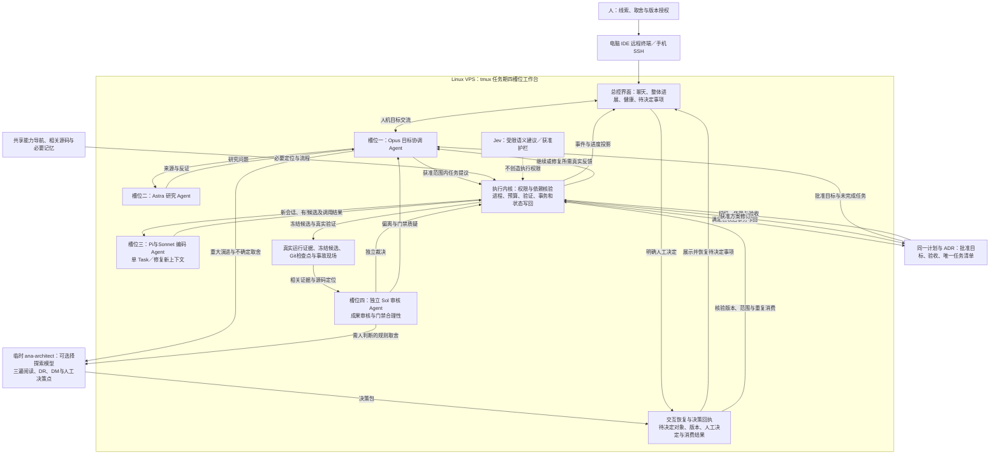
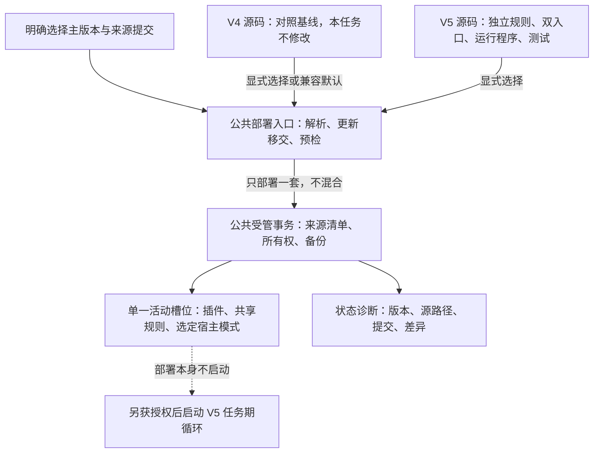
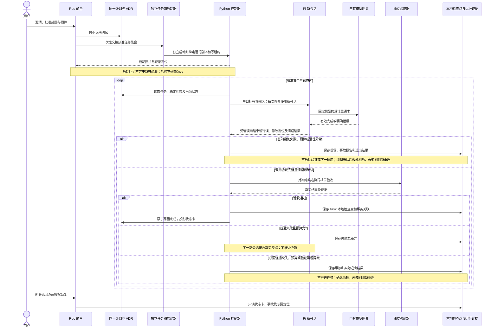

# ADR-20261012：BMRalph V5 独立套件、双入口减负与远程自主执行

- Status: PROPOSED
- 创建日期：2026-10-12；本次修订：2026-10-21。
- 冻结前授权范围（2026-10-20 历史）：2026-10-20 紧急纠偏指令覆盖此前“刷新后继续实施至归档”的本轮推进许可：本次仅修订同一计划与本 ADR、定义关键落点并冻结过度设计路线；不修改或删除生产源码及测试，不运行终端或验证，不调用模型实施编码，不启动后台、不操作 Git、不转正或归档。人类在终端显式启动前禁止自动编码；未来启动仍须绑定审核后的计划版本、任务范围和预算，模式切换、聊天批准、看板重连或文档保存均不构成启动。历史授权、回执和未完成承诺保留，但不作为本轮执行许可；全计划完成后的历史条件归档授权不在本轮行使。
- 会话标识：null；不编造历史或当前会话标识。
- 实施计划：[V5 未完成冻结计划](../archive/plans/plan-20261021-BMAD-ANTI-BUREAUCRACY-20261012-01-frozen.md)，计划标识 BMAD-ANTI-BUREAUCRACY-20261012-01；当前入口绑定此实际冻结目标，不再绑定未来 V4 默认计划。保留全部未完成事项，不在 ADR 镜像任务进度；该副本是历史保全，不是可直接执行的当前契约。
- 演进来源：[执行性能与门禁简化提案](ADR-20261011-bmad-solo-execution-performance-and-gate-simplification.md:23)。本次保持同一任务与原未完成事项，不新建镜像方案。
- 证据边界：设计依据来自客户端返回的仓库文件、安装资产、实际命令回执、用户需求及各历史章节已定位的来源。当前新增 Cline 判断仅使用本聊天取得的安装资产和探测回执，不继承历史回答中未取得来源的能力断言。较早“尚未创建/冻结/已通过”等文字只保留历史语境，不证明当前源码或证据状态；分析入口本轮只进行文档刷新。真实实施和运行按对应回执报告，静态检查、安装说明和模拟不证明客户端断开推进。
- 2026-10-18 私有配置加载阶段的历史授权：替代上方 2026-10-17 冻结边界，允许必要 V5 启动入口、后端、私有加载模块、相关新增反例、说明和版本控制排除规则修改；当时冒烟与循环共享最多 5 次真实模型请求和 60 秒总时限。安装不加载凭据、不启动任务，不读取或输出真实凭据正文、不修改系统全局配置、不覆盖用户改动或 V4。
- 2026-10-18 独立循环阶段的历史授权：当时允许审查并提交相关改动、由固定 Pi 1.3.0 后台实现未完成裁决器、外层独立验证和程序写回；目标及预算保存于同一计划，启动和裁决器单测不证明断开推进。该授权不自动用于 2026-10-19 优化，历史限制及回执保留其原适用范围。
- 冻结前替代关系（2026-10-20 历史）：最新文档限定授权、决策 11 与同一计划重写后的 Phase 7 为当前入口。决策 11 替代决策 10 中 Cline TUI 必须承载统一总控、通用持久人工决定存储及相应新增接线路线；改为独立只读树状看板、人工终端启动和四槽位外层编排。决策 9 与 Phase 6 未被明确替代的安全、验证、预算、检查点及未完成承诺保留，不重建第二套控制平台，不继承历史运行预算或绿灯。计划保持 BLOCKED，ADR 保持 PROPOSED；本 ADR 不复制任务进度。

## 2026-10-21 未完成冻结保全记录

- 当前用户仅授权完整保全 V5 未完成计划及本 ADR 的必要冻结标注；随后特别授权终端防覆盖复制与完整性核对，原生回读文件及修改本头部。该授权不包含 V4/V5 生产代码、部署、模型或后台启动、Git、业务测试、ADR 转正或开发完成归档。
- 当前计划暂停为 SUSPENDED；上方及历史章节的 BLOCKED 描述仅为冻结前状态。本次为未完成冻结保全，非完成归档；ADR 仍为 PROPOSED，八项历史类型化任务状态、验证对象及回执不改写，全部未完成 AC、Epic、Phase 6/7 承诺及授权历史保留，不把旧通过记录升级为当前证据或执行许可。
- [冻结副本](../archive/plans/plan-20261021-BMAD-ANTI-BUREAUCRACY-20261012-01-frozen.md:1)按冻结时的默认源原正文完整保存，保全回执确认全文字节一致，原生回读确认计划身份与暂停头部。原默认路径现已用于独立 V4 计划，不再定位 V5 源正文。副本内旧相对引用一律以冻结时原源文件所在目录为历史基准，而非冻结目标的新目录；历史命令仍按原工作区及原计划路径理解，不自动改写验证对象，不可直接执行，不作为 V4 证据。
- 默认入口交接已取得回执：父分析任务收到完整保全及源最后复核结果，随后完整复读原源并将默认入口替换为[V4 分阶段计划](../pending_implementation_plan.md:1)，写入成功后已全文回读，计划标识为 BMAD-V4-ATTENDED-CLEANUP-20261021-01。本 ADR 仍只绑定上方 V5 冻结副本；此次入口交接不完成、恢复或启动 V5，不修改冻结副本及历史任务回执。
- 无人值守工程迁往 solo-engine 仅为意向，本次不访问或写入项目外目录、不迁移资产或凭据。宿主进程是否停止、写入租约是否释放尚未验证；文档暂停及复制成功均不证明运行时停止或无人值守开发完成。
- 本次文档保全使用平台任务记录引用真实工具回执；未验证控制器覆盖此操作，不宣称程序防篡改保证。历史章节、回执定位与证据适用范围保持原状，不继承旧预算、认证或绿灯，不恢复 V5。

## 1. 上下文与业务驱动 (Context & Business Driver)

目标是在保持编码质量与真实验证的同时，减少重复分析、状态镜像、历史回灌和无意义审批。先删除不必要的工作，再由薄程序承担剩余机械工作，而不是把繁复账本自动化。

- 用户要求保留分析入口的三遍阅读、探索、审计及目标固化；工程入口消费明确需求和现成方案，不取代分析入口。
- 用户希望通过本地 Antigravity IDE 的远程连接提交任务后，关闭客户端，VPS 仍能自主思考、编码、验证并启动下一轮。
- [现行工程规则](../../bmad-suite-v4/roo/rules-bmad-engineer/01-bmad-engineer-core.md:17)已经要求状态单源、取消流水镜像和历史全文回灌；这不证明所有下层流程或宿主加载均已一致。
- 此前客户端返回的外部 Ralph 参考仓库实现每轮调用编码工具，外层依据模型输出中的完成标记退出，没有独立执行测试来裁决完成。该观察仅描述已读参考实现，不证明目标 VPS 的运行时能力；不将本项目的静态契约校验器误作 Ralph 源码证据。
- [参考笔记](../../docs/Ralph-Wiggum-Loop/Ralph-Wiggum-Loop.md:369)中的无头接口、桥接方法与性能数字仅为研究线索。历史回答中未附实际来源回执的 Roo CLI 发布或归档断言不纳入已验证事实。
- 用户报告的超大输入、断流及“1 小时缩短到 20 分钟”保留为症状与效果线索；本次未获得对照测量，不能确定因果或承诺固定提速。
- 本轮用户要求为避免与 V4 混淆、便于审核，将优化版本独立放入 [bmralph-suite-v5](../../bmralph-suite-v5/)，并考虑 [bs.sh](../../bs.sh) 更新；保持同一提案与计划，不另建任务或丢失原未完成事项。
- 已读取的 [部署入口](../../bs.sh:23)默认 V4，主分支部署路径也固定 V4；[标签缓存](../../scripts/tag-cache.py:38)、[缓存来源核验](../../scripts/deployment_provenance.py:89)及[静态校验器](../../scripts/validate-roo-contracts.py:41)同样硬编码 V4。只新增目录或参数不足以接通版本选择全链路。
- [受管源映射](../../scripts/deployment_source.py:75)把不同套件部署到同一活动插件槽位及共享规则目标，模式配置也合并到宿主目标。独立源码目录不是同根双活、权限隔离或宿主实际加载的证据。

可行性裁决：方法论减负及小任务闭环可推进设计；客户端关闭后的执行须先证明目标独立运行时可用，属于条件可行，不声称已实现。

## 2. 完整目标架构

当前目标严格以用户指定的 [`architecture-v5.md`](../../docs/Ralph-Wiggum-Loop/architecture-v5.md:1)及决策 11 为准：人工终端启动、Tmux 四槽位、独立树状看板和文本经验接力。下图保留为决策 10 的历史演进图，其中统一总控与持久决定对象不再是当前实施要求。拟议生产资产仍落入 [V5 套件](../../bmralph-suite-v5/)，不修改 [V4 套件](../../bmad-suite-v4/)；架构选择不证明已经实现或实测。



总控聊天属于 Opus 槽位，临时探索不增加第五个常驻 Agent。界面与决策回执不另建任务进度；IDE 和手机只是接入路径，不承载后台生命周期，也不限制人的编辑习惯。

## 3. 决策与职责

### 决策 1：双入口保留，交接减薄

- 拟建 [V5 分析入口](../../bmralph-suite-v5/skills/ana-solo/SKILL.md)保留三遍阅读、探索、审计和人机目标收敛；不写生产代码、不使用终端、不把可行裁决当作实施授权。
- 拟建 [V5 工程入口](../../bmralph-suite-v5/skills/bmad/SKILL.md)消费明确需求与已结晶方案；小修复不强制完整分析、ADR 或角色会议。
- 共享拟建 [V5 能力索引](../../bmralph-suite-v5/skills/bmad/references/capability-map.md)，明确本地流程、技能注册与运行依赖的区别；先接通高价值能力，不整库加载。V4 仅作只读参照，必要运行资产纳入 V5，不以跨版本引用替代自包含。
- 代码索引只导航，源码仍须按需核验；失效时定向搜索，不启动来源公证或全项目扫描。
- 普通测试失败进入短修复循环；目标、关键假设或重要接口变更才回到分析侧。

### 决策 2：方案可迭代，承诺不能悄悄改写

- 获准结晶后持续修订同一计划与提案 ADR，避免另建重复过程文档。
- 实施开始稳定的是目标、关键决策及验收边界，不是文件字节。任务拆分、顺序、落点和必要发现可以正常演进。
- 目标扩大、验收放宽、关键决策变化及生产操作须明确授权；只暂停受影响部分。
- 拟将计划任务清单作为任务进度唯一载体；状态卡只是程序生成的有界视图，不另建人工总账。ADR 不记录任务进度，回执不复制到计划。
- 模型勾选不能产生通过事实；执行程序依据真实结果核验任务完成。实际权限隔离未验证时，不宣称文件或回执不可篡改。
- 本决策在 V5 中采用不同于 [V4 状态职责](../../bmad-suite-v4/roo/rules-bmad-engineer/01-bmad-engineer-core.md:17)的设计，须同步 V5 入口、模板与显式版本校验器；当前尚未生效，不为此改写 V4 规则或继承其验证结果。

### 决策 3：文档保存与上下文摄入分开

- 保存目标、决策、导航、任务状态和必要证据，不默认生成探索过程报告。
- 完整日志、历史与临时脚本可按用途保留，但不默认进入下一轮，不顺带清理用户资产。
- 输入只组装当前任务、相关约束、必要能力与索引、当前代码和最近有效反馈；启动输入与累计工具结果均设预算。
- Token 可计数时使用 Token，否则披露字节近似；80 行状态视图不是整个请求的预算。宿主自动加载内容也应观察。
- 超限明确标注并保留证据定位；受控输入不得挤掉关键约束。原生附件与未覆盖工具旁路不称已被阻断。
- 新会话不自动恢复旧聊天，但保留未完成修改；分析三遍阅读不每遍重开窗口，在目标或预算边界交接。

### 决策 4：远程 Ralph 是任务期执行程序，不是新人格

- 本地 IDE 是目标固化和任务控制台；收到远程启动回执后，下一轮的模型、工具、认证和状态保存均不得依赖本地客户端。
- 当前唯一生产编码框架为 Pi Coding Agent；多 baseline、academic、factcheck 是同一 Pi 执行链的模型角色，不是新增编码 Agent。其他执行器不再新增适配，历史选型依据见决策 8、当前替代范围见决策 9；固定版本、实际认证、工具权限和清理仍须核验，范围选择不等于运行授权。
- tmux 只承载远程任务进程；存活不证明 Agent 工作，也不保证机器重启或宿主崩溃恢复。
- 不建设 GUI 自动点击、自动续聊或宿主登录态桥接；Antigravity IDE 承载目标收敛与方法论入口，VPS 独立进程承载工程执行。未识别的 IDE 插件不作为运行依赖，方法论兼容不能代替实际规则与权限加载证据。
- Ralph 控制器只选任务、组装输入、启动/停止和管理预算；独立 Agent 自主搜索、思考、修改并解释失败。
- 每轮一个可验证任务，会话内允许短修复循环；下一轮根据真实状态继续同一任务或选择下一项。
- Task 级本地 Git 检查点为后续必选交付，失败现场保全及选择性恢复见决策 9；保留共享工作区与用户已有修改，不提交全部变化。分支接管、自动提交及受控恢复须纳入未来显式授权，推送和部署分别授权，当前仅修改文档。

### 决策 5：真实反馈与适度程序防护

- 拟建 [V5 验证执行器](../../bmralph-suite-v5/scripts/bmad-exec.py)负责类型化操作、实际退出结果、命中/跳过判定、超时、取消和日志预算；目前尚未创建。套件位置与任务工作区分开解析，日志、回执和任务成果不写入套件分发源。
- 拟建 [V5 循环入口](../../bmralph-suite-v5/scripts/bmad-loop.py)复用验证执行器，只提供任务启动、状态和停止，不建设永久服务或复杂 IPC 总线；目前尚未创建。安装与受管部署不启动循环；活动任务绑定核验过的套件来源，更新或版本回切前须停止并确认在途进程结束，不在运行中替换规则和程序。
- 完成口令、文件变化、日志写入成功或 Agent 退出均不能单独证明业务完成。
- 测试失败不推进任务，但可在预算内自主修复；网络/模型短暂故障与代码失败分别处理。权限或认证不足、费用/时间/轮次耗尽和持续无进展明确停止。
- 一个工作区一个活动写入者，取消须确认在途进程结束。生产同机采用独立编码工作区、受限账号和验证环境；分支不是系统权限隔离。
- 保留 L0 环境一次准备、L1 相关批次验证、L2 已批准范围的阶段检查；不每轮安装依赖或执行全量回归。
- 相关实现、测试或环境变化后重验受影响结果；无关文档及状态保存不触发业务重测，不用无限补证代替交付。
- 同一计划的下一批本地实现采用显式获准任务集合，不把全计划散文或所有就绪项视为无限执行授权。程序以独立验证裁决当前任务，失败时在预算内以新会话接收真实反馈继续修复；通过并保存后自动选择集合内下一依赖就绪任务，不要求用户逐任务再次启动。各任务必要输入独立，失败反馈不得错误归属其他任务。
- 分离单次模型请求、工具执行、Agent 会话及批次预算。既有驱动进程上限仍为 30 秒，工具分级为 15/30/600 秒、批次上限为 600 秒；这些上限不证明 Pi 或 Claude Code 内部单请求、工具调用、重试和费用受到同等约束。本轮不提高上限、不猜参数；无法在现有预算内完成试验时停止并请求明确调整，不能取消门禁或把外层调用次数冒充模型调用次数。
- 运行监督器与待修改源码采用隔离运行副本，并接入既有来源绑定和读取租约；候选源码可以在授权范围内优化，但不得热改当前绑定程序后继续运行。升级顺序为停止、确认全部受管进程清理、验证候选版本、经获准边界启用。清理未知阻断新调用和重启；文件锁释放或同账号隔离目录不证明系统权限隔离。
- Pi 条件优先不表示真实后端门禁已打开；版本声明、官方接口文档和静态分发均不证明本机独立运行成功。真实运行时不得声明为隔离夹具，不得继承 IDE 登录态或静默回退 Roo、Claude Code 或其他引擎；未授权或缺少真实轮次、业务验证和清理证据时不宣称自主执行链路通过。

### 决策 6：局部交付和效果测量

- 阶段或本地范围可以交付，清楚区分已验证内容与未覆盖范围；必要验证失败不能包装为完成。
- 经明确范围调整的非适用项不再阻塞本次交付；不能通过模型自行改目标过关。
- 局部交付不自动标记全计划完成或转正 ADR。新增完成状态先与现行校验器适配，不把新枚举当作现有能力。
- 测量总耗时、所有轮次 Token/费用、重复读取与测试、人工中断和缺陷；新会话的重复初始化成本也计入，不承诺固定三倍提速。

### 决策 7：V5 独立源码，部署选择全链路一致

- 用户指定的 [bmralph-suite-v5](../../bmralph-suite-v5/) 是新套件唯一生产源码根目录，容纳插件描述、规则、模式、双入口、引用、运行程序与专属测试。按需物理继承 V4 必要资产后独立演进，不复制整个历史过程、不使用软链接、不运行时回指 V4。现有 [V4 套件](../../bmad-suite-v4/) 在本任务中不修改；这不是整个仓库已冻结或洁净的声明。
- 根目录的 [部署入口](../../bs.sh)、[安装入口](../../install.sh)及[公共部署脚本](../../scripts/)只做跨版本兼容扩展，继续复用受管所有权、备份、预检与事务机制，不复制第二套部署框架。V5 运行与专属测试放入 V5，公共部署回归留在[现有测试目录](../../tests/roo_distribution/)。现有计划与 ADR 保留原路径、标识及未完成事项，不另建镜像。
- 主分支更新、标签提交选择和套件选择是不同维度。有效版本意图必须穿过参数解析、新版入口移交、源码选择、缓存、来源清单、状态诊断及安装入口；不得更新后又部署其他版本。未指定版本的新安装兼容默认暂保留 V4，首次启用 V5 要显式选择；已有安装执行无版本更新时，保留受管来源记录中已核验的激活版本，在更新或切换主分支前确定并传递该意图。记录缺失、损坏或无法唯一判断时阻塞并要求显式选择，不按默认回切 V4。默认切换是另外的决定，不由新目录或主分支更新隐式触发。多个不同版本、标签契约冲突或选定源缺失均停止，不静默回退。
- 标签缓存以实际提交与套件身份联合核验；同一提交内 V4/V5 不误复用。旧 V4 缓存保留兼容，V5 采用独立缓存命名空间；不自动改写旧标记或接管损坏缓存。标签名仅提供线索，最终核验提交中的目录与身份，不把 V4 标签内容当作 V5。
- 来源清单拟增加套件身份、主版本及仓库内源路径，状态输出还保留提交与源差异信息；不把仓库提交号、默认参数或当前 HEAD 当作已部署架构版本。新增 schema 与旧清单兼容须由工程实现；旧记录不能唯一判断版本时明确报告未知，不为展示而伪造元数据。
- 首轮建议保留单一活动插件槽位和现有模式标识，以减少迁移变量；展示名称和来源元数据必须明确 V5。同一部署根只激活一套共享规则，另建插件目录不能解决全局规则和模式冲突，因此不建设同根双活。V5 试用先用显式临时部署根；独立宿主配置、实际加载与权限仍须验证。
- V4→V5→V4 回切通过受管事务处理，只退役所有权确认且未被用户修改的资产，保留第三方配置、用户改动、备份和未完成恢复证据，不删除整个插件或规则目录。源码版本存在不等于已部署回切，更不等于宿主加载完成。
- 已有部署的版本操作复用同一固定部署锁，不另建第二套锁框架：[公共版本守卫](../../scripts/deployment-version-guard.py)须在仓库更新、分支切换或标签缓存准备前获取排他锁，跨新版入口移交持续持有；最终受管部署仅借用经 Linux 内核锁记录核验的描述符，不释放外层锁。环境标记和描述符编号不能替代持锁证据；已有部署缺失锁时失败关闭，不补造锁，只读版本预览不获取写锁。此协议仅约束针对同一部署根、遵循公共入口的操作，不保证跨部署根的共享来源冻结或同账号恶意写入隔离；活动任务仍须绑定已核验来源，并在全部在途进程结束后释放读取租约。对应验收契约见[计划验证矩阵](../pending_implementation_plan.md:148)，不以局部互斥替代完整任务期循环与取消门禁。
- 活动任务来源绑定采用[V5 来源绑定模块](../../bmralph-suite-v5/scripts/bmad_suite_source.py)与[共享读取租约](../../bmralph-suite-v5/scripts/bmad_suite_lease.py)组合：先持有现有部署锁，再核验明确的 V5 身份、受管物理文件、来源摘要及分发映射；接管、契约变化和阶段边界发现变化时停止对账，不补造来源、不恢复旧文件、不覆盖用户修改。只读取部署根，不访问记录中的来源仓库；部署时提交记录不证明当前 HEAD 或远程版本。该一致性机制不保证同账号防篡改，不替代宿主模式语义、事务完成诊断、运行时加载或权限核验；任务期调用方仍须接入并确认全部在途进程结束后才释放租约，不能以原语存在或局部测试代替循环与取消门禁。
- 静态校验按显式套件选择分别检查各版本自己的规则、模板和模式，验收命令以[计划验证矩阵](../pending_implementation_plan.md:136)为准；V4 通过不得替代 V5 验收，静态检查不证明运行时权限或远程行为。未实现的运行操作不得编造子命令。

版本与执行边界如下，均为目标设计：



### 决策 8：运行时替代关系与条件选型

本节是同一 PROPOSED 提案内的替代条款，不新建 ADR，不改变已有接受决策的历史范围，不镜像任务进度。以下来源编号属于本节的局部引用，不继承此前无实际检索回执的编号。

#### 证据与替代范围

- Roo 官方仓库页面显示仓库已于 2026-05-15 归档、只读；据此淘汰其作为本项目后续演进的优先适配对象，不推导“所有既有安装不能运行”。主机未安装是用户陈述，历史目录空列表不能独立证明该事实。[1]
- Pi 官方编码 Agent 文档将自身描述为极简、可扩展的终端 Agent；RPC 文档明确采用子进程及标准输入/输出 JSONL，适合语言无关集成，SDK 文档另提供进程内 TypeScript 接入。当前这些是上游接口说明，不是目标安装的能力回执。[2][3][8]
- Pi 的统一 LLM 层文档包含提供方、认证、Token 和费用跟踪抽象；这支持模型中立方向，但不证明选定提供方、模型、认证或计费在目标安装可用。[4]
- Claude Code 官方文档提供非交互 CLI、结构化与流式输出、工具授权选项；这支持将其保留为兼容候选，不证明其协议与 Pi 相同，也不证明任意提供方 BYOK 已满足。[5]
- 用户指定的 Pi 旧仓库地址本轮读取后跳转到 earendil-works/pi；安装前必须重新绑定实际上游身份、包名、固定版本或提交和发布产物，不从旧名称猜安装命令。[6]

替代条款：本提案原决策 4、决策 5、未决条件及关联计划 Epic 5 中“优先独立 Roo 运行时”的当前设计假设，由“Pi 条件优先、Claude Code 待核验兼容、无自动回退”替代。Phase 3/4 历史描述、已有测试名称和回执保留，不把历史 Roo 反例重命名为 Pi 验收，不删除既有部署兼容承诺。

#### 决策矩阵与硬门禁

先检查目标技术栈、来源生命周期、实际权限和预算，再比较方法论适配；不以星数、宣传、未经实测的速度或主观加权总分决定。证据等级仅说明证据强度：E0 为尚无充分证据，E1 为官方文档/源码静态证据，E2 为目标安装资产证据，E3 为获准真实运行证据；它不是产品优劣评分。

| 维度 | Roo CLI | Claude Code | Pi Coding Agent |
|---|---|---|---|
| 生命周期门禁 | 官方仓库归档，淘汰新增优先适配；不判定既有资产不可用 [1] | 官方非交互文档可读；固定版本、目标安装与后续支持尚未核验，E1 [5] | 官方仓库及接口文档为 E1；前序接管报告官方 1.3.0 已安装，本轮不重装，安装与版本查询不提升为 E3 [2][6] |
| 模型自由度 / BYOK | 淘汰后不继续补评，不凭增强议题给分 | 当前读取页面不足以证明任意提供方接入，E0；保留兼容候选 [5] | 统一提供方和认证抽象有依据，E1；目标提供方与模型仍须核验 [4] |
| 无头 / RPC | 历史发布线索不是本机可用接口，不继续投入 | 非交互、JSON 与流式接口有文档依据，E1；不称与 Pi RPC 线协议相同 [5] | RPC 与 SDK 为上游静态证据，E1 [3][8]；当前本地方案实际采用后端内固定版本单次 JSON 薄驱动，协议反例不证明目标模型运行 |
| 方法论承载 | 原规则资产保留，不再建设独立 Roo 执行适配 | 官方文档支持工具授权；完整规则装载和输入预算映射尚未验证，E1/E0 [5] | 极简可扩展 harness 与薄控制器方向相符；规则装载、扩展权限及预算仍未实测，E1/E0 [2] |
| 等待、取消、清理、费用 | 不追加取证 | 官方流式结果含会话与成本元数据；强制停止和预算覆盖仍未验证，E1/E0 [5] | 有 RPC 取消命令及用量抽象线索；目标版本取消、进程清理和强制预算仍未验证，E1/E0 [4][7] |
| 目标 VPS 两轮独立运行 | 未通过且停止新增适配 | 未试跑，E0 | 未试跑，E0 |
| 本轮裁决 | 淘汰新增优先适配 | 待核验的协议兼容候选，不自动启用 | 条件优先，不是运行验收通过 |

Pi 胜出的是本轮架构方向：用户要求模型中立，已有提供方抽象及语言无关 RPC 证据，与 Python 薄控制器的分工相符。[3][4] 不宣称 Pi 比 Claude Code 更快、更安全或接口更成熟；实际安装、权限、清理或预算任一硬门禁不满足时停止 Pi 接入，不静默选择第二名。

#### 静态接入矛盾与冻结边界

此前第三遍推演保存为历史设计依据；当前源码落点与授权已变化，静态推演及协议反例仍不算真实 Pi 运行实测：

- [后端加载边界](../../bmralph-suite-v5/scripts/bmad_agent_backend.py:41)已接受真实 Pi 类别，[薄驱动](../../bmralph-suite-v5/scripts/bmad_agent_backend.py:81)位于同一后端模块，固定官方来源、包身份与 1.3.0，并限制启动参数；不新增独立生产驱动，不换引擎或引入变体。
- [循环真实运行门禁](../../bmralph-suite-v5/scripts/bmad_loop.py:353)仍拒绝非夹具，[入口枚举](../../bmralph-suite-v5/scripts/bmad-loop.py:19)仍冻结。因此仅修改后端不能真实接通；本轮不得绕过门禁或把 Pi 标为夹具。
- [任务验证契约](../../bmralph-suite-v5/scripts/bmad_state.py:62)仍仅支持 Python 单测。公共静态检查不裁决完整任务块或运行时能力；完成候选必须经[精确证据核验](../../bmralph-suite-v5/scripts/bmad_state.py:172)，不能用普通查询 PASS 或测试数量替代。

当前方案替代此前“独立薄驱动＋独立 tests_pi 目录”的规划：复用[现有后端内薄驱动](../../bmralph-suite-v5/scripts/bmad_agent_backend.py:214)，采用固定版本单次 JSON 模式、封闭文件输入和新进程/临时会话参数，不建设永久 RPC 服务；[新增测试](../../bmralph-suite-v5/tests/test_pi_backend.py:1)放在现有测试目录，不迁移既有测试。原生 Pi、Claude Code 和本项目协议分别映射，不宣称线协议互换或已有 Claude 适配器。

这一落点使后端及旧测试目录集合真实变化，必须承担六项完成证据失效与四组定向重验成本：完整保留原环境、目录、模式、下限、必需测试及输入顺序，不删输入、不降断言、不修补旧回执。P5 本地验收保留原八类防线和独立新会话、三轮熔断、写租约/同组清理、外层客观验证四项不变量；逐项真实标识映射及唯一任务进度只保存于[同一计划 Phase 5 契约](../pending_implementation_plan.md:83)，不在 ADR 镜像。

行政恢复没有现成产品接口。本轮受限草稿经单独授权，在既有写租约、源版本和确切 SUSPENDED/空回执状态保护下复用内部[_save_plan](../../bmralph-suite-v5/scripts/bmad_plan_adapter.py:167)，只改 P5-PI-DRIVER 为 PENDING 并原子保存/核对；不修改生产原语、不增加控制平台或第二份账本。旧任务刷新采用已有[refresh_completed](../../bmralph-suite-v5/scripts/bmad_plan_adapter.py:131)，新任务登记采用已有[complete](../../bmralph-suite-v5/scripts/bmad_plan_adapter.py:100)，均须真实匹配证据。未覆盖的行政入口及静态检查引用平台实际回执，不宣称通用恢复或账号防篡改能力。

真实接入的候选最小解冻仍限于循环门禁的明确授权/真实证据判定，是否改入口枚举先评估既有无头入口。未经独立授权不实施；不取消来源绑定、独立验证、预算或清理门禁。任务裁决、来源映射或其他冻结核心若有实际缺口，另列必要变化、影响与最小验证，不扩大本轮白名单。

#### 后果、接受及归档条件

- 保留 Phase 1–4 冻结原语和历史完成源记录；纯文档及测试目录外草稿变化不触发业务重测，实际后端、测试集合或环境变化才重验受影响证据。前序[Pi 27 项回执](../verification/phase5-20261017/run-9be9f0dd13d846d8af453b82d1a190e4.verdict.json)、[后端 17 项回执](../verification/phase5-20261017/run-4e9b1d1f9b9e427982b26e3eca84ca09.verdict.json)和[循环 18 项回执](../verification/phase5-20261017/run-ee40ad634ddf4029b8abcfaed647afe1.verdict.json)仅为前序接管依据，须按当前身份与任务契约核验，不继承有效性或覆盖旧回执；后两份定向回归不自动匹配六项旧任务。协议单测和安装报告均不证明真实 Pi 编码。
- 规则与模式是方法论资产，不假设 Pi 自动加载 Roo 模式配置；在工程接管时建立明确的提示词、技能、工具权限和自动加载映射。提示词白名单不是操作系统隔离。
- 初次适配不建设永久 RPC 服务。每次修复使用新进程/新会话，保留未提交成果，只携带必要约束与真实失败反馈；业务通过后由原程序选择下一获准依赖就绪任务。
- 关闭客户端指关闭本地 IDE/观察连接，不是切断 VPS 到模型服务的网络。模型 API 断网属于失败关闭试验，不能要求无网络时继续产生模型步骤，不修改宿主防火墙或 SSH。
- Pi 两轮真实运行回执是本提案接受的必要条件，不是充分条件：还须独立失败→反馈→新会话修复→业务通过→程序选下一任务、客户端关闭后的新步骤、预算停止和真实清理，以及本提案其余适用必需门禁全部满足，并取得转正授权。保持 PROPOSED，不能靠两个退出零接受。
- ADR 接受不等于全计划完工。原 Epic、全部 AC 和范围外承诺继续保留；仅绑定活动计划全部必需事项完成且归档获准时才归档，不能因引擎转向或局部两轮验收提前归档。

#### 本节证据定位

1. [Roo 官方仓库归档标记所在页面](https://github.com/RooCodeInc/Roo-Code/issues/11966)：本轮检索返回页面的仓库归档元数据，不采用议题提案作为已实现接口证据。
2. [Pi 官方编码 Agent 说明](https://github.com/earendil-works/pi/blob/v1.0.0/packages/coding-agent/README.md)：本轮取得极简、可扩展终端 Agent 的说明；此标签只定位该说明，不表示已选定安装版本。
3. [Pi 官方 RPC 说明](https://github.com/earendil-works/pi/blob/main/packages/coding-agent/docs/rpc.md)。
4. [Pi 官方统一 LLM 层说明](https://github.com/earendil-works/pi/blob/main/packages/ai/README.md)。
5. [Claude Code 官方非交互文档](https://code.claude.com/docs/en/headless)：本轮直接读取正文；未据此声明目标安装可用。
6. [用户指定的 Pi 官方仓库入口](https://github.com/badlogic/pi-mono)：本轮直接读取返回的新仓库身份为 earendil-works/pi。
7. [Pi 官方 RPC 命令说明](https://github.com/earendil-works/pi/blob/main/packages/coding-agent/docs/rpc-commands.md)：本轮检索取得取消当前操作并等待会话空闲的说明；会话空闲不证明所有受管后代进程已结束，不据此生成完整取消/清理命令。
8. [Pi 官方 SDK 说明](https://github.com/earendil-works/pi/blob/42a3497d/packages/coding-agent/docs/sdk.md?plain=1)：本轮检索取得进程内 TypeScript 接入说明；提交定位不代表已批准该版本或 SDK 接入方式。

本轮已实际直接读取用户指定的 Pi 仓库入口与 Claude Code 官方非交互页面，并检索上述 Pi RPC、提供方、统一 LLM 层、SDK 和 Roo 仓库归档元数据。直接读取、检索摘要、标签及提交页面只支撑其明确覆盖的静态内容，不是安装、认证、权限、费用强制预算或真实独立运行回执。各条来源定位不得冒充完整正文审计；Pi 与 Claude Code 的固定协议版本、安装包身份、请求级超时和进程清理边界仍须工程阶段取证。

### 决策 9：Pi 单框架、确定性上下文与可靠交付（2026-10-19）

本节在同一 PROPOSED ADR 内演进，不创建新提案、不自动接受、不镜像进度。替代决策 8 的“Pi 条件优先、Claude Code 兼容候选”为“仅 Pi 编码框架”；补充决策 3–5 的上下文、检查点和事故协议。历史任务、回执、部署兼容和全部未完成承诺保留；当前按头部最新授权推进相关本地工程与必要验证，真实运行和 Git 操作分别受门禁限制。

#### 确定性分配：重建输入，而非保证输出或无限循环

- 用户提供的[参考笔记](../../docs/Ralph-Wiggum-Loop/Ralph-Wiggum-Loop.md:49)作为理念线索：每轮一个明确局部目标，以磁盘状态和真实反馈重建新会话。不是模型推理确定、Token 消耗可预知或每轮必然进步的证明；笔记中的学术数字、速度和四变体断言不纳入运行事实。
- 外层验证失败后的修复启动新 Pi 进程/会话，只装配当前任务、稳定约束、相关导航/流程、当前源码与差异、最新真实失败。完整会话历史和追加日志不默认摄入；有效工具往返与网关同一响应恢复不是外层新任务。
- 单轮上下文容量、累计 Task Token、物理请求截止、逻辑续接截止、连续无有效回复及工程验收分别控制。具体候选数值和未决门禁只保存于[计划 Phase 6](../pending_implementation_plan.md)，不在本 ADR 复制预算或状态表。
- 用户的连续失败意图是有效回复到达则清零网络计数并继续，不是累计若干次请求就结束。通信恢复不代表业务验收通过，不清零累计预算；新会话、切模型或网关内部重试不能绕过累计约束。部分续接能否清零及其完整性标准尚待确认。
- 费用计算与优化不列为本轮必需门禁，但 Token 口径、缺失用量、失败请求和网关内部重试覆盖必须诚实登记；计量未就绪不能用字节数冒充 Token 硬上限。总时限/总轮次未批准时保持执行阻塞，不默认无限运行。
- 不引入主观语义评分器或“黄金三轮”定律。文件变化和回复到达不证明验收改善；独立测试决定是否晋级，最新错误/修改快照提供事故定位。旧无进展规则的保留或替代先对账，不静默取消。

#### 一次性交接与物理数据流

以下为目标时序，不代表已存在或已验证的启动接口；当前允许相关本地实现与必要验证，不启动真实模型或后台任务。



- Roo 子任务若使用，只承担一次性启动交接；不承载主循环、不要求每轮切视图或续聊。启动接口须核验真实宿主能力，不能从工具名称推导 Pi 子进程启动权限。
- Roo 与 Pi 使用同一获准工作区，控制器管理单写入链；前台执行期不并发编辑。锁约束协作写入，不提供同账号权限隔离。控制器运行副本继续冻结，不允许正在执行的程序被 Pi 热改后继续使用。
- 最小介质是绑定计划/ADR、显式任务请求、写租约、唯一任务清单、只读状态卡、运行/退出回执、检查点事务及事故现场；不新增轮询总线、永久平台或第二份进度账本。
- Pi 可提出任务拆分、定位和必要发现，由控制器检查并写回；稳定目标、授权、验收放宽及 ADR 裁决仍回到人工。新发现不自动晋级为已接受架构事实。
- 独立长跑为必选，优先用固定 baseline 和最少任务证明客户端关闭后的新步骤、真实失败修复、外部通过与下一任务。再接研究模型/Jev，最终验收组合链；tmux 存活、源码变化或零退出不能替代。

#### 外部记忆与 Task 检查点

- 索引、流程和经验复用采用薄导航/同义词定位、已验证稳定经验、最新失败及未完成修改；按需读取，不全文复制经验流水。当前[参数组装](../../bmralph-suite-v5/scripts/bmad_agent_backend.py:126)关闭自动加载；[显式记忆接入](../../bmralph-suite-v5/scripts/bmad_context_inputs.py:71)仅装配请求指定的非秘密索引及完整必要材料，校验计划/Task 身份、源字节、别名与累计字节预算，不把复制技能文件当成加载证据。源字节一致不证明经验语义正确或模型容量；未知能力与真实读取门禁保留。
- 只读记忆在[批次接管](../../bmralph-suite-v5/scripts/bmad_plan_adapter.py:49)和[循环阶段边界](../../bmralph-suite-v5/scripts/bmad_loop.py:422)绑定；当前或后续任务记忆变化时停止对账，不覆盖旧绑定、不启动下一调用或登记通过。获准任务源码仍可修改；本地反例不替代真实 Pi 新会话、客户端断开或检查点验收，不改变历史任务状态。
- [状态投影](../../bmralph-suite-v5/scripts/bmad_state.py:189)仍来自唯一清单，不能把散文 Epic 自动视为全部已纳入。新增工作须迁入覆盖其验证类型的同一契约；未覆盖前平台记录只跟踪实施过程。卡片保留全部未完成事项和检查点/事故定位，超预算阻塞而不悄悄裁剪。
- Task 本地检查点为必选；共享工作区使用获准本地任务分支，不推送、不自动合并主分支、不强制切换，不默认另建 worktree 改变拓扑。已有脏修改与目标重叠或索引所有权未知时先处理授权，不提交用户暂存内容。
- 独立验收绑定冻结候选，随后持久事务准备、提交获准成果、保存验收与提交/tree 关联、原子完成写回、重建卡片后才推进。Git 和计划文件不具备天然跨介质原子性：提交成功/写回失败须对账，不重复提交或伪造完成。
- [检查点候选原语](../../bmralph-suite-v5/scripts/bmad_checkpoint.py:1)已实现显式非秘密普通文件冻结与独立单测验收关联，绑定计划、运行、Task、接管源身份及验收覆盖；不推断既有修改所有权。关联前后核验候选、源码、快照、回执和计划身份；变化、保存或同步失败不返回成功，保留现场供对账，残留关联文件不能继承通过。本地原语不操作 Git、不提交、不恢复、不写唯一任务进度，也不提供跨介质原子性或同账号防篡改保证。索引与分支所有权、持久事务、提交/tree 关联、完成写回、循环接入及事故恢复仍待实现和分别验收；[本地反例](../../bmralph-suite-v5/tests/test_checkpoint_guards.py:1)不能证明真实 Task 提交、后台断开或恢复能力，必需运行证据缺失时本 ADR 保持 PROPOSED。
- 失败先停止并确认受管清理，保存差异、新文件及恢复所需元信息；按预授权选择性恢复受管路径。并发/所有权冲突、现场保存失败或恢复失败均保持阻断。禁止危险全库清理，上一绿色只代表其相关验收，不代表全计划通过。

#### 网关故障、安全挂起与恢复

- 保留完整协议和生命周期检查；102 字节提前 EOF 是用户报告的症状，不足以定位是网关、上游、代理或协议原因。独立诊断须记录连接、状态、首事件、累计正文、结束标识及真实错误，不用健康页面成功替代流式完成。
- 网关缓冲补全要区分逻辑请求与物理尝试，核验身份、顺序、去重、完成和用量归属。缺续接契约不拼接独立回答，未完成工具调用不得执行；有效续接不会自动改变任务验收。
- 认证/权限失败停止，网络重试仅在批准的连续失败及总量预算内；持续普通失败按批准的工程预算停止，不因偶尔收到文本无限延期。
- [共享网络预算原语](../../bmralph-suite-v5/scripts/bmad_pi_budget.py:21)已支持显式连续失败门限，跨传输会话及模型复用同一对象时保留计数，达到门限后锁定阻断；[传输状态聚合](../../bmralph-suite-v5/scripts/bmad_pi_transport.py:340)反映该阻断并保留原失败诊断。HTTP 完成不自动清零，回复确认只核验当前请求归属和完整传输事实，须由调用方先完成原生协议验收；该确认尚未接入 Agent 原生验收路径或循环操作契约，不能证明语义有效或业务通过。会话结束的生命周期不能逐一关联会话内物理请求；[后端禁启门禁](../../bmralph-suite-v5/scripts/bmad_agent_backend.py:410)在环境复核、会话文件、转发和进程启动前拒绝启用未接通的连续失败运行策略，不改变既有未启用门限的固定模型路径或授予新运行权限。默认运行不暗启新门限，本地六次失败夹具不授予真实调用预算，不替代 Token 计量、续接、自动事故挂起或恢复证据，未决运行门禁保持未决。
- 事故现场保存身份、原因、真实网络/验证回执、修改快照和检查点、预算、清理结果及需授权的恢复步骤；脱敏，不把凭据或完整研究输入泄漏给路由服务。未执行的检查留空，不制造测试事实。
- [事故现场保存原语](../../bmralph-suite-v5/scripts/bmad_accident.py:1)仅保存显式非秘密文件白名单和回执身份定位，不解释回执业务状态，不执行取消、提交或恢复，不改唯一任务进度。工作区固定位置的持久标记已接入[受管循环启动门禁](../../bmralph-suite-v5/scripts/bmad_loop.py:1)，在现场写入前保存；未对账、残缺或伪成功标记均禁止新启动，更换运行目录不得绕过，旧标记不覆盖、不自动解除。标记创建失败且未留下文件时不能保证持久禁启，须停止并保留失败回执；未知清理不得宣称可重启。此门禁不取消在途进程、不覆盖平台工具旁路或提供同账号防篡改保证；路径过滤不证明任意源码正文无秘密。自动事故捕获、实际取消清理、挂起与新实例恢复仍须分别接入和验收，本地文件保存及禁启反例不能替代这些运行证据。
- 人工挂起先映射现有 SUSPENDED 显示语义；新增状态须实现版本契约。清理或落盘未知保留持久阻断，锁释放不证明安全；恢复经授权创建新工程实例并重新核验，不恢复旧进程或自动重放工具副作用。

#### Jev 受限路由：功能添加评估，不宣称最佳模型

- 本次重新取得的一手检索结果确认：Jev 用于结构化决策，不是编码 Agent 背后的聊天或代码补全模型替代品。[4][2] 官方入门页提供 SDK、API、Agent skill 及浏览器试用四种接入方式；这些静态说明不证明本机适配已实现。[3]
- Jev 是独立的快速结构化决策组件，选择获准模型及后续动作，不替代 Pi、编码模型、网关研究或独立验收。先建立获准模型注册表，过滤协议、窗口、输出上限、工具和引用能力，再接受受限推荐；合法结构化输出不证明推荐正确或模型最佳，未知能力不得补造。
- 最新用户澄清：baseline、baseline:academic、baseline:factcheck 是网关三个完整模型选项，后两者由网关提供网上搜索，不拆成角色配置。联网研究默认完整 ID 为 gpt-6-astra:academic；事实核验使用获准对应完整 factcheck 选项，精确 ID 从非秘密配置核对。普通编码默认 Sonnet 5.5 baseline，其精确 ID 待非秘密配置定位；计划简化优先核对既有 gpt-6.1-sol 候选，不引用此前无依据的性能排名。不支持编码工具的模型只执行受限研究，外部文本不增加权限、不替代业务测试。
- 选择在明确任务/新会话边界发生，一个工程会话内模型固定。人工固定优先；Jev 不可用或推荐不合契约时沿预授权固定策略，不新增候选或动作，不让新增路由阻塞固定模型闭环。缺对应预授权只阻塞该动作，不自动转发全量源码或使用 IDE 登录态；不中途切换残缺响应、续接或在途工具调用。
- Jev 路由为本次新增评估与受控实现目标，但不阻塞固定 baseline 独立运行测试；接口、来源/版本、端点/认证、数据出站、延迟及调用预算须核验。自有网关是否提供 Jev 尚未知，不自动绕过网关调用外部平台。
- 教程、扩展目录和历史聊天中提到的路由方式只作候选线索；当前没有足够证据确认具体扩展已审计或兼容 Pi 1.3.0。未验证插件不默认安装，不放开全部扩展。兼容性证据不足，保持未决，不把官方模型角色说明当成当前主机接入证明。
- 不引入通用决策提供方平台、委员会、成本优化或上下文压缩。本轮比对人工固定规则与 Jev 推荐在代表性任务上的选择及实际验收；错误候选、低置信、服务失败均不能绕过权限/预算/测试。最小落点优先薄路由模块，只有真实接口要求才增加受限 Pi 扩展。

本节引用仅对应 2026-10-19 本次重新检索返回的来源编号，定位保存如下；决策 8 的旧编号仍限于其历史节，不跨节复用。实际查询为“site:docs.typesafe.ai Jev \"System One\" \"coding agents\" \"Quick start\" structured decisions SDK API agent skill browser”。本次取得的是页面检索结果，不称全文代码审计，不证明安装、认证、路由质量或当前主机兼容。

```json
{
  "retrieved_on": "2026-10-19",
  "scope": "本节 Jev 静态角色与接入方式；本次重新检索",
  "sources": [
    {"source_id": 4, "title": "System One", "url": "https://docs.typesafe.ai/concepts/system-one"},
    {"source_id": 2, "title": "Jev with coding agents", "url": "https://docs.typesafe.ai/introduction/coding-agents"},
    {"source_id": 3, "title": "Quick start", "url": "https://docs.typesafe.ai/introduction/quickstart"}
  ]
}
```

#### 交接与接受边界

- 最小顺序与任务/依赖、预算、未决项及资产定位保存在同一计划 Phase 6；控制器尚未覆盖的实施进度仅使用平台任务记录，不在 ADR 镜像回执或状态。新增真实运行和检查点门禁不能伪装成本机单测；未创建资产不标 AVAILABLE，不填测试名称或通过回执。
- [模型路由契约](../../bmralph-suite-v5/scripts/bmad_model_router.py:1)与[只读选择入口](../../bmralph-suite-v5/scripts/bmad-exec.py:125)仅核对显式完整模型选项及预授权策略；注册表不创造调用权限，未知 ID、能力和容量不补造。选择结果不发送请求、不执行后续动作，不证明 Jev 已接入或后端会话已采用该模型。
- [第一版回执快照校验](../../bmralph-suite-v5/scripts/bmad_pi_evidence.py:1)仅承担旧格式兼容与失败关闭；其历史字节预算边界不批准 Phase 6 运行，不替代 Token 计量。合成输入通过不证明实际断开推进、检查点或事故恢复，不改变历史任务状态。
- 当前允许相关本地工程与必要验证；真实模型调用、后台启动、自动提交及选择性恢复分别等待明确范围与预算。历史启动授权和数值预算不继承；缺真实运行预算不阻塞可独立完成的本地实现，不推送、不生产部署、不接受或归档。
- 保持 PROPOSED：固定及获准多模型链的独立推进、记忆、检查点、异常/清理与全部适用门禁获得真实证据且转正获准后才接受；局部阶段完成不结束全计划或触发归档。

### 决策 10：Cline 条件总控、Opus 协调与四槽位人工版本决策（2026-10-20）

本节保留历史取证和选型依据；当前界面、存储路线与启动授权以决策 11 为准，不继续扩张本节的通用人工决定存储和 Cline 总控接线。

#### 目标与明确替代范围

- 用户要求随时从电脑或手机接入 VPS，在同一人机交互入口看到整体任务、各槽位运行/健康和需人工事项；不要求人分析历史会话文件才能决定是否放行。
- Opus 是认知协调者，负责整体计划/ADR 偏离度、工作优先级、研究和修复提议。程序执行内核核验授权与依赖，管理生命周期、预算、客观验证、检查点和进度；不代替 Agent 做产品取舍，也不由 Agent 口头裁决制造完成事实。
- 四职责为 Opus 总控、Astra 研究、Pi/Sonnet 编码和独立 Sol 审核。Sol 分别审核成果和门禁是否与风险相称；不确定取舍进入临时 ana-architect，经三遍阅读、DR、DM形成决策点交给人，不新增第五个常驻槽位。
- 每次实质性需求演进、重大重构、关键 ADR 替代、验收或重要门禁变更都由人决定是否执行；批准范围内排序、普通修复和下一任务自动推进。不是一次授权永久运行，也不是每保存一次进度都重新审批。
- 替代决策 4、5、9 中 Roo 一次性交接作为主要控制面的假设，以及前台只能观察、程序独自选择工作重点的设计。Pi 保留编码框架，Cline 条件承担总控交互与 Opus 协调，不属于新增第二条独立编码循环。
- 决策 9 的预算、真实验证、单写入链、输入重建、受控事务与事故约束继续适用；旧时序图保存历史设计，不覆盖本节。研究后缀保留完整模型选项，增加研究角色不拆改网关模型语义。

#### 证据分层与安装探测边界

- 用户已安装 Cline；[安装包元数据](../../../.nvm/versions/node/v22.23.3/lib/node_modules/cline/package.json:3)声明版本 3.0.73。实际探测定位到用户安装入口和缓存产物，文件类型回执为 Linux x86-64 ELF；版本命令尚未运行，不能把包声明写成版本运行验证。
- [包装器](../../../.nvm/versions/node/v22.23.3/lib/node_modules/cline/bin/cline:3)说明它以 Node 解析内嵌 Bun 的平台产物。当前安装不是纯 Rust CLI 的证据，不再以实现语言作为本工程选型门禁。
- [随安装附带的说明](../../../.nvm/versions/node/v22.23.3/lib/node_modules/cline/README.md:84)描述交互 TUI、结构化事件、后台模式；[功能描述](../../../.nvm/versions/node/v22.23.3/lib/node_modules/cline/README.md:109)还记载差异渲染、MCP、子 Agent/团队和连接器。这些提升为目标安装资产证据，不提升为本机真实模型、外部 Pi 汇总或审批恢复的运行证据。
- [提供方说明](../../../.nvm/versions/node/v22.23.3/lib/node_modules/cline/README.md:70)和[配置选项](../../../.nvm/versions/node/v22.23.3/lib/node_modules/cline/README.md:246)为自定义接入和状态隔离提供线索；精确提供方、协议、认证保存及网关工具调用仍须核验。不得把示例中的命令行密钥作为生产凭据传递方案。
- 首次 PATH 查询未命中，随后找到了实际安装；不从 PATH 缺失推导未安装，不重装或修改 Shell 配置。[证书逻辑](../../../.nvm/versions/node/v22.23.3/lib/node_modules/cline/bin/ca-certs.cjs:178)存在写入路径；命名空间探测已被系统拒绝。因此先前只读授权下没有启动 Cline，帮助、配置/TUI和模型连通均未实测。
- 不绕过该权限拒绝或提升系统权限。获准项目内临时状态也不等于安全隔离；工程入口须依据实际接口保证不读取既有凭据、不请求模型、不启动后台服务，保证不了则停止对应探测，继续独立的本地实现。

#### DM：先门禁，再比较最小改动

沿用决策 8 的证据等级：E1 为上游静态证据，E2 为目标安装资产，E3 为获准真实运行。等级不是产品得分；没有实际成本、缺陷或兼容性测量，不生成加权总分。

硬门禁为：保留人工版本决策；总控/后台不依赖本地 IDE在线；Pi编码与独立审核可分权；同一任务与决定对象可重连；现有资产可保护；预算和权限不能被新入口旁路。目标安装文档有接口线索不等于这些门禁通过。

| 候选 | 当前证据与改动边界 | 裁决 |
|---|---|---|
| 已安装 Cline TUI承载Opus总控，薄接入现有Pi与执行内核 | E2：有交互、事件、MCP和批准线索；外部槽位、业务决定、重连与权限边界未到E3 | 条件首选，先验证最小接线，不宣布全部门禁通过 |
| 小型独立总控界面，复用Opus与现有后端 | 仅设计：可明确统一事件和决定契约，但新增界面实现 | 接口不足时提交给人的备选；不得静默替换首选 |
| 深度维护Cline/Roo私有Fork | 未取证具体实现，新增上游维护责任 | 首轮不采用，不凭猜测分支推荐安装 |
| 全部编码与循环迁移Cline | 已有Cline安装，但Pi契约、预算和事务需重新映射 | 当前不采用；未证明必要，不扩大本次迁移 |
| Roo聊天作为唯一后台控制入口 | 当前没有实时外部槽位推送和业务决定恢复的运行证据 | 仅可选兼容入口，不作为独立执行的必要依赖 |

条件选择的理由是复用已安装交互入口，同时保留现有Pi、验证、记忆、预算与事务资产。它是最小迁移假设，不是“同源即无成本”的事实；是否可薄接入由实际接口和反例决定。

#### DR：最强反例与停止条件

- 双执行权威：Cline自身工具、子Agent或后台任务可能绕过现有内核。总控只获得研究/读取/任务提议和决定呈现所需能力；不得直接写业务、提交或启动独立循环。实际工具限制、Hooks或MCP能否强制该边界必须核验，仅提示词或逐工具批准不等于硬隔离。
- 批准偷换：Cline工具批准可能被误当作新计划执行授权。[批准说明](../../../.nvm/versions/node/v22.23.3/lib/node_modules/cline/README.md:327)还记载默认自动批准。人的方案决定必须独立绑定请求身份、版本和执行范围；不得把模型调用批准工具当成人按了放行。
- 后台无回显：[后台模式说明](../../../.nvm/versions/node/v22.23.3/lib/node_modules/cline/README.md:319)记载CLI提交后不保持输出、全工具自动批准及与TUI/隔离数据模式不兼容。因此裸后台模式不作为本工程默认；tmux只承载，不代替人机决定和恢复协议。
- 聊天持久不等于运行恢复：待决定、人工回执和消费结果要保存到明确对象；重连只恢复展示，不启动任务、不继承旧编码会话。进程崩溃后的重新接管另验，不能把会话历史或tmux存活当作自动恢复证据。
- 独立审核共同盲区：Sol不能读取编码聊天和辩解，必须基于冻结候选、相关源码/接口及真实测试；模型身份可核验，但跨模型仍不保证零幻觉。流程门禁质疑与代码通过分别裁决，任何一方不得抹掉真实失败。
- 人并发编辑：系统不能控制人的IDE习惯；检测相关内容变化，保留人改动并暂停受影响操作。不能要求人永远只读，也不能因工作区协作锁宣称外部修改不可能。
- 手机与电脑重复决定：决定提交和消费需要版本核验、幂等及并发冲突处理；过期、重复、拒绝和不确定均不能自动变成新授权。
- 总控上下文退化：高频日志与槽位心跳由程序投影，不全文注入Opus；跨目标协调只保留当前目标、未完成项、必要发现和决定定位。换会话不允许丢弃关键依赖。

裁决为条件采用、尚未运行验收。若原生界面无法呈现业务决定或无法限制总控工具，不通过软提示包装成成功；呈现已发现缺口、保留资产，交给人选择薄界面备选或明确架构调整。

#### 数据、权限与人机交互职责

- 唯一任务进度仍为同一计划清单；状态栏和聊天整体状态均从它及真实事件投影。新增操作未被控制器覆盖时，平台记录为唯一临时工程进度，不同时维护散文、卡片和平台三套状态。
- 交互恢复与决策回执只保存决定对象、提案版本、人工选择、有效范围及消费结果，不另记任务完成。人正常使用只看总控聊天和决定操作，不需要分析后台文件。
- 总控界面包含持续状态区、人↔Opus聊天、待人工决定和按需槽位细节；健康区分存活、有效事件、等待人工、网络异常和清理/预算阻塞。未知或过期状态不能显示健康。
- Sol门禁质疑或Opus发现重大演进时，保存决定请求并暂停受影响执行；人可选择获准探索模型进入临时ana-architect，得到保留/放宽/替换的影响与依据。人批准新版本后按新契约验证，原失败事实保留。
- 电脑IDE远程终端和手机SSH接入同一tmux工作台；总控属于Opus槽位，不增加第五个常驻Agent。手机访问是验收目标，尚未实测，不依赖未经核验的手机Agent安装包。
- Jev的推荐和安全护栏分别绑定契约。推荐失败只使用预授权策略；必需护栏失效则阻断对应动作，不静默用聊天模型替代并宣称同等安全。具体来源/版本、Pi兼容、出站数据和预算待核验；不开放全部扩展。
- 研究、编码、审核和总控的真实请求均归属明确父任务/运行预算；切角色、重开会话或网关重试不得重置累计计量。当前精确模型、认证方式和完整运行预算尚待确认，不复制历史预算当新授权。

#### 最小执行与关闭条件

- 任务、依赖、源码落点及验收只保存于[同一计划Phase 7](../pending_implementation_plan.md:218)，不在ADR镜像工程状态。先工程接管和Cline安全接口探测，实例化统一事件/人工决定契约，再做总控最小闭环和四角色分权；原网关、记忆、检查点、事故、研究/Jev未完成项仍须推进。
- 最关键真实验收为：获准任务启动 → 客户端断开后新事件 → Sol质疑门禁 → 临时探索与待人工请求 → 重连同一入口看到整体情况 → 人批准具体变更 → 新契约下继续任务。还须覆盖真实失败修复、独立审核、检查点、依赖推进及取消/预算停止；安装说明和模拟不能代替。
- 当前用户已要求完成后归档，不再把归档描述为完全未授权；但归档只在全部原有及新增必需事项完成后实施。需要延期或变更旧承诺时先由人明确决定，不删旧事项制造全计划完成。
- 本ADR保持PROPOSED，缺运行证据不接受。全部适用门禁满足后按契约确认接受；归档保留原标识、历史状态、回执和失败定位，目标含时间及计划标识，防覆盖保存并复核源版本，失败保留源。不推送或生产部署。

### 决策 11：四槽位外层编排、独立看板与 Harness² 文本经验机制（2026-10-20 紧急纠偏）

#### 决策与替代边界

- 采用 [`architecture-v5.md`](../../docs/Ralph-Wiggum-Loop/architecture-v5.md:8)定义的职责拓扑：Opus/Cline 规划、Astra 研究、Pi/Sonnet 编码、独立 Sol 盲审；Tmux 承载任务期进程，确定性程序管理流转，独立 Rich 树状看板只展示。四槽位不要求四模型常驻，看板不是第五个 Agent。
- 本地 Antigravity IDE 保留 GUI 差异审查与文档预览；客户端不安装额外 Agent、不承载后台生命周期。规划可以产出方案，但不能自动启动编码；获准范围内的普通修复和依赖推进仅在人类显式启动后的任务期内自动进行。
- 取消 Cline TUI 必须统一汇总外部槽位和持久审批交互的前置要求；Cline 仅保留规划适配候选，不维护上游 Fork、不增加第二条编码循环。独立看板为当前方案，不再因 Cline 总控接口缺口阻塞看板设计。
- 冻结 [`bmad_control_store.py`](../../bmralph-suite-v5/scripts/bmad_control_store.py)、[`test_control_contract.py`](../../bmralph-suite-v5/tests/test_control_contract.py)、[`test_control_store.py`](../../bmralph-suite-v5/tests/test_control_store.py)及相关决定查询扩张路线。现有源码、测试和历史回执原地保留，不继续扩写、不作为新流水线必需依赖；本轮仅文档冻结，不声称源码导入或运行入口已禁用。后续解耦须明确获准，不删除资产来制造测试通过。
- 用户报告的代码膨胀、上下文爆炸及 API 报错作为纠偏线索；本轮不重新统计行数、不证明唯一因果，也不把已有局部测试通过当成运行链通过。

#### 状态、卡片与经验各司其职

- [`state.json`](../../.solo/state.json)是单一、可重建的显示快照，不是数据库、执行队列、授权记录或第二份任务清单。仅外层编排器写入，看板只读；身份、当前 Task/轮次、槽位状态、阻塞原因及证据定位足够，不保存聊天、完整日志或全历史。
- 状态总线核心读写逻辑不超过 50 行；采用一次性完整快照替换，缺失、损坏或过期显示未知，不能据此启动或确认完成。该上限不包括 Rich 展示和既有执行防护，但不得把复杂存储逻辑转移到其他模块绕过瘦身目标。
- 任务清单继续是任务进度唯一来源，真实回执保存事实，卡片仅保存当前 Task 的差异/接口定位、验收和检查点关联，经验文件只保存可复用规则。卡片或快照写入成功不能覆盖验证失败。
- 文本经验采用用户指定的 Improvement Harness／Experience Reflector 思路：独立 Sol 在 Task 结束后依据验收、差异和真实错误提炼一条有适用边界的教训，由程序去重后追加至 [`experience.md`](../../.solo/experience.md)。没有可验证的新教训时不强行编造；反射不增加第五个模型槽位。
- 新 Task 顶部注入有界、相关的精炼经验作为初始脚手架，同时保留当前目标、授权、验收、必要源码和最近失败。经验不得覆盖硬门禁、扩大权限或改变验收；不摄入完整日志和旧聊天，不承诺零幻觉或必然自我改进。
- 经验仅在 Task 边界追加并为下一新会话重新绑定；当前会话读取快照不热更新。此条明确替代决策 9 中将所有未来经验文件永久冻结的解释，保留必要输入完整性与预算约束；不引入索引数据库、自动调参或未经授权的额外训练循环。

#### Jev、独立审核与三轮熔断

- Jev 定位为编码工具调用前的语义护栏，不负责选择执行权限或替代审核。目标配置为启用 pi-jev 的无 UI 阻断；精确配置键、固定 Pi 兼容性、网络失败策略及出站数据须以后续一手接口核验为准，不能仅凭配置文字宣称已阻断。
- 必需护栏不可用、缺认证、超时或输出非法时阻断对应动作；不静默回退普通聊天模型并宣称等价安全。路径范围、账号权限、预算和真实验证仍由既有执行边界承担。
- 编码与每次外层修复均启动新会话；Sol 盲审不读编码聊天、思考或辩解，只读验收、冻结差异、相关源码和真实测试结果。Sol 的经验反射在盲审裁决后进行，不能用编码者总结替代审查证据。
- 每 Task 最多三轮编码候选，包括首次尝试；验证失败或审核驳回消耗同一轮数，第三轮失败即挂起，禁止第四次编码调用。架构图中“大于三轮”的标注仅表示到达熔断分支，不授予第四轮；网络重试另受运行预算，不重置工程轮数。
- 通过顺序为候选冻结、外层相关验证、独立审核、候选复核、获准 Git 检查点及任务写回，再生成显示投影并进入下一依赖任务。提交/写回中断保留现场、停止推进，不用重启循环重复副作用。

#### Gate #2 与本轮交付

- 本次仅两份文档修订及关键落点定义；人类终端显式启动前禁止调用编码模型或实施生产代码。重连看板、切换模式、保存计划、模型批准和安装均不能启动执行。
- 未来启动必须明确审核后的计划版本、任务集合、写入范围和预算；重大需求、ADR、验收或权限变化仍先交给人，随后以新版本重新显式启动，不建设通用审批数据库。
- 四个原子组件、依赖、落点及验收只记录在同一计划 Phase 7。既有生命周期、来源保护、预算、检查点和事故资产优先复用；历史任务与未完成承诺保留，不以四组件设计完成冒充全计划完成。
- Harness² 的具体论文、仓库身份及 Experience Reflector 实现本轮尚未取得可核验一手正文；上述文本经验机制记录为用户指定的设计选择，不写成论文已证明 Markdown 优于数据库，不继承前序回答无对应来源回执的引用编号。该未知不阻塞文档结晶，不允许虚构性能或有效性结论。
- ADR 保持 PROPOSED，计划保持 BLOCKED；本轮不验证、不转正、不归档，也不自动交接实施。

## 4. 备选方案裁决

| 候选 | 裁决 | 原因 |
|---|---|---|
| 继续增加提示词警告或角色会议 | 否决 | 不解决重复工作和运行生命周期，增加上下文与审批成本 |
| 用脚本加速原多文档账本 | 否决 | 仍需维护重复信息，状态保存继续产生额外验证 |
| 只延长网关超时或切换模型 | 不作为本任务方案 | 未证明网络因果，不能替代工作和输入减负 |
| 永久调度平台、复杂多智能体与记忆数据库 | 否决首轮建设 | 先接通一个小任务闭环，再按实际缺口扩展 |
| 完全冻结计划或无条件覆盖活动入口 | 否决 | 前者制造桥接文档，后者可能丢失未完成任务 |
| 直接搬运 Ralph 提示词与完成口令 | 否决 | 不能替代真实验证，全文进度日志会重新膨胀 |
| IDE 面板自动化作为断开后的运行依据 | 不满足当前硬门禁 | 除非证明远程运行时独立；不能只证明点击成功 |
| 独立运行时＋薄循环＋受控验证 | 条件采用 | 须核验目标引擎与远程断开能力；保留双入口和自主思考 |

## 5. 历史不变量、修订关系与非目标

- 保留[已接受生命周期 ADR](ADR-20261008-roocode-bmad-v42-lifecycle-and-governance.md:37)中的显式任务优先、历史恢复授权、分析权限、第三方资产保护与真实证据边界。
- 拟细化该 ADR 第 4 节：新需求不默认搜索历史归档；归档发现仅适用于明确的继续/恢复意图。已有未完成活动任务不被自动覆盖。
- 拟在 V5 演进该 ADR 第 5、7 节有关工程执行与状态职责：任务清单作为唯一进度、受监督的任务期进程作为执行增强、只有受影响证据才重验。提案接受与相关实现前，不宣称替代条款已经生效；不修改 V4 对照规则或原历史接受范围。
- 不修改已接受 ADR 或其项目事实记录；不把历史任务的通过状态继承到新任务。
- 受管部署的所有权、备份、事务保护和低频防覆盖仍保留，取消日常微步指纹不适用于删除这些安全机制。
- 当前非目标：不修改生产源码、V4、项目事实或已接受 ADR，不覆盖用户改动；不建设永久平台，不实施网关服务改造，不执行宿主激活、远程任务、Git 提交/回滚、推送、发布、转正或归档。网关适配、自动检查点和受控恢复是后续交付目标，不是本次操作权限；不保证全部模型兼容或宿主崩溃自动恢复。

## 6. 最小充分验收与失败模式

原环境复用、取消微步对账、有界结果、真实失败和受控回滚要求继续保留；具体阶段与资产状态以[本任务计划](../pending_implementation_plan.md)为准，不在 ADR 镜像进度。

首轮远程验证只聚焦三组：

1. 客户端关闭后：远程 Agent 完成当前步骤并自主启动下一轮，而非仅 tmux 或循环进程存活。
2. 新会话必要记忆：不恢复完整聊天，相关约束、未提交成果、未完成任务和有效失败反馈仍可使用；累计输入/输出预算真实生效。
3. 真实失败与有界停止：测试失败、不命中必需测试、Agent 退出异常和取消均不得产生假通过；预算内可修复，停止后成果和必要结果可查。

最关键的失败模式及应对：

- 运行时仍依赖本地宿主：在首个能力试跑淘汰，不先建设 GUI 桥接。
- 新会话每轮灌入全部规则和历史：预算覆盖受控输入与工具累计输出，相关材料按需加载。
- 模型写通过状态或文件变化提前触发下一轮：等待实际执行结束并以真实验证结果裁决，取消确认在途进程结束。
- 失败修改与用户改动被自动回滚或提交：独立工作区、单写入者和明确提交范围；不执行全目录恢复。

## 7. 拟执行验证与实施顺序

本节命令保留为历史验收入口，不默认执行或重复全量验证。当前实施顺序以同一计划 Phase 7 为准，未被替代的 Phase 6 要求继续适用；分析入口完成文档刷新后移交工程入口，按实际资产、授权及依赖实例化任务和必要验证。历史证据须核验适用性，失败阻断与成果保护继续保留，阶段通过不替代全计划完成。

```bash
timeout 30s python3 -B scripts/validate-roo-contracts.py --suite v5 --plan _bmad-output/pending_implementation_plan.md < /dev/null
```

命令入口见[静态校验器](../../scripts/validate-roo-contracts.py:303)。它已支持显式 V4/V5，但只做对应配置及计划元数据检查，不执行计划命令，不验证完整任务块、新增驱动或真实模型行为；不改写校验器来制造通过。

当前仅按决策 11 修订 Phase 7 的四组件文档规格，不继续统一人工决定存储或 Cline 总控接线，不自动进入工程。未来由人明确启动后复用既有执行防护，按相关验收推进；真实请求、认证、Git 操作及恢复仍须对应范围与预算。全计划接受及条件归档保留为后续事项，本轮不行使，不运行上方历史命令。

## 8. 未决条件与交付状态

本节较早本地接管及授权条款保留历史；当前以头部文档限定授权、决策 11 和重写后的同一计划 Phase 7 为准。未被替代的 Phase 6 安全要求与未完成承诺继续适用；不运行历史命令、不恢复旧进程、不继承旧预算，本轮不实施或归档。

- Pi 为唯一编码框架；前序安装报告不证明本次模型、协议、技能、清理或断开推进能力。Jev 兼容、自有网关多模型/续接、Token 硬计量、Task 检查点和事故协议均须后续证据；费用优化不列本次必需门禁，不新增其他编码执行器。
- 同一计划保留历史局部交付、任务状态、回执及全部未完成承诺。此前工作树和清理报告只保留历史定位，本次未检查 Git 或进程，不重新认证其有效性，不恢复旧进程；文档回读不证明运行门禁通过。
- 当前范围以决策 11、同一计划 Phase 7 和最新紧急纠偏授权为准：仅两份文档结晶和关键落点定义。此前本地实施、验证与继续到归档的推进许可不自动延续；等待人类终端显式启动及对应范围、预算，不推送、不生产部署、不恢复旧进程或继承历史绿灯。ADR 接受及全计划条件归档均不在本轮执行。
- 真实试跑前集中确认主机/工作区/运行时版本、显式任务集合、写入白名单和禁止改动的验收资产、独立认证及变量名称、确切生命周期命令、请求/工具/会话/批次时限、轮次/调用/费用预算和计量缺口、客户端关闭后新步骤证据采集、取消与清理未知时的重启阻断。不得读取或回显凭据正文。
- 保持 PROPOSED。原 Pi 真实推进要求、四槽位分权、总控重连、人工版本决定及全部适用必需门禁满足后，按契约确认接受。全计划完成前保留活动计划；归档已有完成后的条件授权，执行时须防覆盖保存并复核源版本，缺证据不放宽验收。
