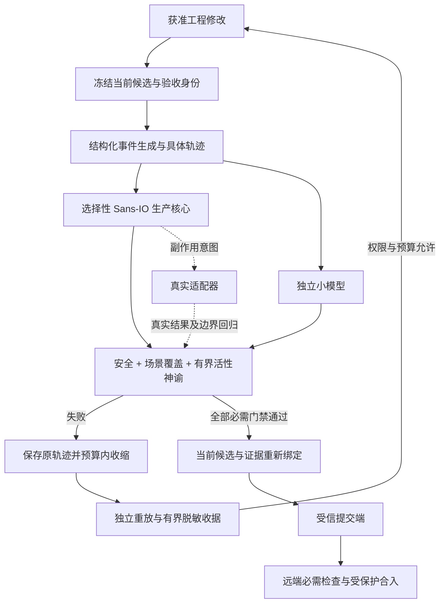

# 生产级动态属性背压：DR 反向审查与 DM 决策报告

- 日期：2026-10-21。
- 状态：条件可行的分析提案；未实施、未运行测试、未获生产接受。
- 会话标识：null。
- 当前授权：读取相关资产、保存本分析报告；不运行终端、不修改生产代码、不恢复冻结任务、不提交、不部署、不转正或归档。
- 保存说明：用户指定的草稿写入被当前分析模式的路径权限拒绝，未保存成功；本报告使用用户原先明确授权、且模式允许的最终分析路径。不绕过权限、不切换工程模式。
- 证据范围：当前会话实际收到的工作区读取结果。第三方项目及库接口未进行本轮外部一手核验，版本、发布状态和性能结论不得继承材料中的自称核验。

建议选择“现有 Python 栈内的选择性 Sans-IO 核心 + 状态机属性测试 + 独立小模型 + 有界反例收据 + 内容绑定的受管提交/合入门禁”。先打通一个危险决策边界，不建设通用仿真平台，不把固定删测比例、十倍缺陷收益、五步反例或一次修复当作已经证明的效果。

## 一、391 行核心资产解构与生产级提炼

### 1. 三遍阅读与证据分层

第一遍：材料从第 391 行开始提出控制面资源声明、强类型、属性测试、模糊测试和确定性测试的组合，随后给出四步闭环及五项最佳实践。[1]

本任务的类别是工程验证与 Agent 修改约束的结构设计。目标是同时获得深层错误发现、低维护负担和执行级失败拦截；非目标是证明全部程序行为、模拟整个操作系统、迁移全库语言、恢复旧无人值守任务。

第二遍：可复用的是设计机制，不是材料附带的性能数字。“编译期砍掉 80% 状态空间”“获得商业平台 90% 能力”“跨机器永久比特级一致”“任意缺陷秒级收缩”等主张，在当前项目没有实测支持。[1]

第三遍：虚拟重实现以“候选内容—验证结果—候选变化—授权撤销—最终提交裁决”为切片，追查旧证据重放、验收身份漂移、合法路径永远拒绝和副作用执行前权限变化。推演不是实测，不构成门禁通过。

证据分类：

- 用户目标：生产可用、高 ROI、避免脆弱边缘测试和纯文字护栏。
- 已读取事实：当前 CI 展示配置契约与隔离分发测试；已读配置没有提供本次属性测试或远端分支保护的启用证据。[3]
- 已读取事实：V5 受管提交代码存在候选/验收身份关联与隔离索引，但也拒绝未纳入批准的活动 Git hook。[4]
- 已读取事实：相关 V4 提案主张属性测试与必要回归互补，V5 暂留冻结；该 ADR 状态是提案，不是已接受的部署事实。[2]
- 推断：局部确定性核心有利于收缩与模型对照；其实际迁移成本、反馈耗时和缺陷收益仍未知。

### 2. Ash 资源模型：借鉴约束集中，不借用自动正确性

材料将 Ash 控制面解释为集中声明资源属性、动作、权限策略和唯一性，并明确承认 Marshall 使用的部分扩展未知。[1]

可迁移的工程资产是“资源约束集中、动作边界显式、拒绝路径可执行”，不是引入 Elixir 或复制其整个控制面。现有 Python 工程应分开三种约束：

- 结构约束：输入字段、状态标签、值域，由边界校验负责。
- 领域约束：合法迁移、预算守恒、幂等身份，由核心决策负责。
- 权限和存储约束：当前执行权、实际路径所有权、唯一性与并发更新，由执行适配器和真实存储边界负责。

资源声明不能自行保证审计、租户隔离、事务和权限吊销全部生效。必须审查所有副作用入口是否实际经过裁决；旁路写入不会因声明存在而消失。

裁决：保留资源驱动的约束集中思想，不引入 Ash/BEAM 作为本任务前置依赖，不使用材料中的微进程内存和性能数字进行选型。

### 3. 强类型契约：尽量排除非法结构，不夸大 Python 保证

拟采用 Python 类型标注、状态变体和运行时输入校验组合。若工程阶段选用 Pydantic，本报告以第 2 代接口为骨架假设，实际版本与依赖就绪状态尚未知。

避免“一个状态对象加十几个可空字段”：未验证、验证通过、验证失败分别建模，通过态必须带候选身份、验收身份和回执定位。不得用布尔值加任意字典表示批准。

刚性要求：

- 外部数据通过单一边界解析，拒绝多余字段和不合约定的隐式转换。
- 核心只接受已解析事件；迁移结果仍检查领域不变量。
- 优先使用不可变叶值、元组和受控构造；冻结外层对象不代表嵌套对象深度不可变。
- 禁止把跳过校验的构造、未经校验的更新复制当作外部入口。
- 静态类型检查属于开发防错，不是 Python 的运行时权限沙箱。
- “验证通过”数据仍可能伪造或过期；执行边缘必须核对真实证据、当前内容与当前授权。

结论：“非法状态不可表达”在本栈应解释为受控接口内尽量不可构造；不能承诺像严格静态类型语言一样在整个运行环境中绝对不可表达。

### 4. Sans-IO：控制决策宇宙，不控制整个宿主

核心消费“状态 + 明确事件 + 逻辑时间 + 已选随机结果”，产生“新状态 + 副作用意图”。真实时钟、随机选择、网络、文件、进程和认证读取均在边缘。

关键区别：

- 测试中的延迟、重复、乱序和失败是事件数据。
- 生产适配器仍执行真实 I/O，并把实际结果返回核心。
- 核心产生提交或写入意图，不等于获取执行权。
- 不能从应用事件顺序测试推断真实线程锁、文件系统或内核竞态全部正确。

可靠重放资产不是只有 Seed：保存初始状态、规范化事件轨迹、逻辑时间、随机选择结果、核心内容身份、契约和依赖版本。Seed 便于重新探索；具体轨迹才是优先修复输入。

毫秒级重放是小型纯核心的可测目标，不是全流程 SLA。真实 Git、文件同步、进程清理和远端 CI 延迟必须单独记录。

### 5. Always / Sometimes：安全、非空跑和活性是三件事

材料的成对断言强调：仅有安全不变量时，全部输入被入口拒绝也可能空跑通过。[1]

生产提炼必须区分：

1. 安全：每一步都不得违反权限、内容身份和状态迁移底线。
2. 可达性：必要场景确实到达被测深层决策，而且合法路径确实成功。
3. 有界活性：在故障停止、持续获得执行机会等明确前提下，每个已接受操作在规定逻辑步数内完成或进入契约允许的明确终态。

某个场景发生过一次，不证明所有请求最终完成。这里使用 Sometimes 作为方法论标签，不假设 Hypothesis 内置同名断言，也不声称 Antithesis 平台断言在普通本地运行时天然阻断测试。

覆盖义务应由独立场景见证保证，随机轨迹负责扩展组合。不要要求每个随机样例都命中全部稀有事件，否则会制造波动和干扰收缩。

### 6. 影子模型：对照语义，不复制实现

小模型只保留可观察事实，例如当前候选身份、有效验证身份、授权版本、已接受操作和完成状态。不复制缓存、锁、网络协议或数据库事务。

模型与生产逻辑消费同一事件，但不能调用同一转移函数或同一授权判断，否则共享错误可以一致通过。可以共享事件格式，不能共享待检验决策。

比较经过规范化的业务视图与外部效果：错误类别、是否接受、目标内容和最终可见结果。不要逐字段比较私有状态布局；异步逻辑只在契约定义的观察点或收敛点比较。

模型不是“绝对正确”。关键底线再配独立不变量、已知反例和负控；模型行为也由人工审查。固定 50 行模型不能作为质量门槛。

### 7. Shrinking：减少反例，不伪造全局最小

失败闭环建议：保存原轨迹 → 记录属性和失败签名 → 预算内收缩 → 在固定版本独立重放 → 形成收据 → 获准工程修复 → 重放原反例并进行新的随机探索。

收缩必须保持同一错误语义。删除前置事件后退化成参数解析异常，不算原权限或一致性缺陷的成功收缩。

不能保证任何百步错误都压到五步：有些失败确实依赖长历史，收缩算法也受策略和预算限制。报告应区分“已简化”“相对特定删除规则不可再删”“预算耗尽”，不声称全局最小。

五步以内是优选反馈形态；语义完整、可重放和预算有界才是硬条件。不要为了达成五步而合并操作、丢弃因果依赖或更换失败属性。

## 二、生产级动态背压规范

### 1. 三层架构

第一层：领域契约与核心决策。负责合法状态、授权版本和内容/证据关联，禁止隐式 I/O。

第二层：动态验证。负责结构化事件生成、独立模型、安全/覆盖/有界活性神谕及反例收缩。

第三层：执行背压。受信验证端作出裁决，提交端绑定确切待提交内容，Agent 接收有界失败收据；失败、证据缺失和身份漂移不能推进。



图示是建议架构，不是宿主拓扑或工具权限证明。

### 2. 最小代码骨架

以下为文档内接口骨架，不是新增生产文件，也未运行验证。它仅说明“带标签的状态 + 显式事件 + 返回意图”，没有实现可信回执读取或 Git 执行；必须由工程阶段补齐真实边缘并验证依赖接口。

```python
from typing import Annotated, Literal
from pydantic import BaseModel, ConfigDict, Field, TypeAdapter

class Value(BaseModel):
    model_config = ConfigDict(strict=True, frozen=True, extra="forbid")

class Pending(Value):
    kind: Literal["pending"] = "pending"
    candidate: str
    acceptance: str

class Verified(Value):
    kind: Literal["verified"] = "verified"
    candidate: str
    acceptance: str
    receipt: str

State = Annotated[Pending | Verified, Field(discriminator="kind")]
state_parser = TypeAdapter(State)

class Event(Value):
    kind: Literal["passed", "failed", "changed", "request_commit"]
    candidate: str
    acceptance: str
    receipt: str | None = None

class CommitIntent(Value):
    candidate: str
    acceptance: str
    receipt: str

def decide(state: State, event: Event):
    matches = (event.candidate, event.acceptance) == (
        state.candidate, state.acceptance
    )
    if event.kind == "changed":
        return Pending(candidate=event.candidate,
                       acceptance=event.acceptance), ()
    if not matches:
        return state, ()
    if event.kind == "failed":
        return Pending(candidate=state.candidate,
                       acceptance=state.acceptance), ()
    if event.kind == "passed" and event.receipt is not None:
        return Verified(candidate=state.candidate,
                        acceptance=state.acceptance,
                        receipt=event.receipt), ()
    if event.kind == "request_commit" and isinstance(state, Verified):
        return state, (CommitIntent(candidate=state.candidate,
                                    acceptance=state.acceptance,
                                    receipt=state.receipt),)
    return state, ()
```

骨架边界：通过事件必须来自受信验证端，字符串身份不是认证；权限撤销、预算、路径授权和可信证据检查尚未展示。提交意图必须交由执行适配器在真实操作前复核，不能直接调用 Git。

为保持收缩粒度，测试生成正常业务动作和故障结果，不把长业务链隐藏进一个“万能动作”。只有真实产品操作本身具有该原子边界时，才以单个事件表示。

### 3. 高价值属性模板

| 属性 | 安全神谕 | 必要可达性见证 | 活性前提与检查 |
|---|---|---|---|
| 旧验证不可批准新内容 | 候选或验收身份变化后，不产生旧证据绑定的提交意图 | 旧证据确实进入最终裁决；当前合法证据确实被接受 | 当前候选稳定且验证服务正常时，可完成新验证 |
| 撤权立即限制后续执行 | 生效的授权版本之后，不执行新增越界副作用 | 存在撤权前成功和撤权后拒绝的观察 | 不承诺撤销已完成效果；在途效果按契约处理 |
| 幂等操作 | 同一幂等身份不产生重复可见效果 | 重复事件确实跨过解析进入去重逻辑 | 重试可服务且无永久失败时，获得同一结果 |
| 有界恢复 | 恢复中不丢失已确认事实、不覆盖外部修改 | 至少有独立故障恢复场景完成 | 停止故障并保证服务机会后，在逻辑预算内收敛或明确阻塞 |
| 模型一致 | 规范化可见结果与独立模型相等 | 正常、拒绝、重复和变化场景均有见证 | 异步效果只在约定观察点比较 |

不能对任意操作随意声明交换律。只有业务证明独立的操作才能交换；同一资源上的撤权与执行、修改与提交通常顺序相关。

### 4. 覆盖与生成器规范

- 合法操作、非法输入、故障恢复分开建测试目标，避免全部预算消耗在解析层。
- 状态机根据当前状态生成可执行操作，并用受控句柄关联资源，减少大量过滤。
- 必要场景采用独立确定性见证；随机测试记录深层迁移命中、合法接受、拒绝原因和恢复终态。
- 分支覆盖是补充信号，不等于领域覆盖。测试命中分支但没有产生真实业务结果，仍可能空跑。
- Hypothesis 状态机测试作为首选生成/收缩工具候选；覆盖率引导字节模糊测试只在解析器、协议或二进制边界有具体需要时另行引入，不把两者混称为已经具备的统一引擎。
- 禁止把运行次数、日志长度或 Seed 数当作缺陷覆盖证明。

### 5. 最小收据契约

Agent 反馈建议不超过 8 KiB；可计量 Token 时同时设置 Token 预算。该数字是初始工程预算建议，需按客户端实际限制调整，不是已测吞吐或模型能力阈值。

| 字段组 | 必须保留的内容 |
|---|---|
| 身份 | 收据版本、任务、被测内容身份、验收身份、依赖及引擎版本 |
| 失败 | 属性标识、错误类别、失败签名、首个失败步骤、期望/实际语义差异 |
| 重放 | 初始状态或完整快照定位、规范化事件、逻辑时间、选择结果；Seed 为辅助 |
| 收缩 | 原始/剩余步数、预算与耗时、终止原因、独立重放裁决 |
| 证据 | 原轨迹、完整日志及状态差异的项目内定位与内容摘要 |
| 安全 | 脱敏状态、日志作为不可信数据处理、不可扩张工具权限 |

收据超过预算时不直接向 Agent 回灌全文：保留完整反例资产，只传身份、失败、语义摘要和按需读取定位。若这些必需信息本身仍放不下，报告预算阻塞，保留缺陷，不自动修复、不改为通过。

原始日志和反例同样可能包含恶意指令或秘密；按数据读取，先脱敏，不能把错误输出当作新的执行授权。

### 6. 刚性拦截与 Git 的真实边界

必须明确“阻断什么”：

1. 受管 Agent 提交：受信执行端只允许验证覆盖的确切候选进入提交；失败或证据漂移时拒绝。
2. 普通本地提交：hook 可提供快速反馈，但拥有 Git 操作权限者可能绕过；不能声称所有本地提交不可绕过。
3. 远端合入：受保护分支与必需检查构成合入防线，须限制绕过权限并取得真实配置/运行证据。

要求“失败严格阻断 Agent 提交”时，不能给同一个不受约束的 Agent 任意更新目标仓库引用、修改门禁或伪造 PASS 的能力。受信验证资产和提交端应与编码写入面隔离；未具备隔离时只能承诺合作式门禁，并披露缺口。

检查待提交树，而不是仅检查工作树。部分暂存会使二者不同；验证内容、测试资产、验收契约和相关依赖身份必须绑定。候选变化后重验受影响证据，不按时间新鲜度猜测旧 PASS 是否有效。

现有 V5 代码拒绝活动 hook，因此直接增加 hook 可能与现有契约冲突；不能热改冻结控制器或把该静态候选当作当前 V4 已部署能力。[4]

### 7. 三界红线

| 层级 | 识别条件 | 本报告裁决 |
|---|---|---|
| 轻量玩具 | 只有文本、日志或固定 Mock；没有领域神谕、具体重放、收缩及执行拦截 | 拒绝作为生产背压主体 |
| 生产可落地 | 选择性确定性核心、结构化 PBT、独立模型、非空跑义务、真实边缘回归、可信裁决与内容绑定 | 条件推荐，需阶段验收 |
| 顶级虚妄 | 本任务要求全库语言迁移、商业 Hypervisor 或自研通用分布式仿真平台 | 排除于本次范围，不否定其在其他场景的价值 |

“少写 80% 边缘单测、多发现 10 倍真实 Bug”保留为待验证收益假设。不能为了达成指标机械删测；已有缺陷回归、真实 I/O、并发及恢复边界必须保留。

## 三、DR 反向推翻审查

### DR-1：虚真与生成器质量风险

预先验尸：随机数据全部在参数层被拒绝，安全检查持续通过，合法功能却根本不工作。

对冲：

- 生成器优先产生合法状态和已存在资源，再注入越权、重复、版本漂移等领域故障。
- 覆盖义务不只看事件被生成，还看被测决策被执行、合法路径成功、拒绝原因符合契约。
- 每个关键安全属性建立相关场景见证，但不强行机械一对一；多个属性可以共享经过审查的深层场景。
- 三类负控必须被发现：关闭业务入口、永远拒绝、删除关键检查。前两类被非空跑义务发现，第三类被安全神谕发现。
- 覆盖汇总与失败收缩分开；不能因缩短轨迹没有达到整轮覆盖配额而改变原错误。

停止条件：无法定义“什么才算合法业务成功”或覆盖负控检测失败时，先修验收与生成器，不扩大随机次数。

裁决：成对属性接受；“Sometimes 一次命中等于全面活性保证”推翻。

### DR-2：状态机和影子模型膨胀风险

预先验尸：为模拟全部文件系统、恢复日志、进程树和锁，复制第二套产品，验证投入再次吞噬业务。

适用条件：有跨步骤身份、重试、重复投递、撤权、缓存一致性或明确恢复状态；存在可分离决策核和可观察语义。

不适用条件：简单纯函数、一次性映射、关键风险主要来自真实内核/数据库行为，或者参考模型不得不复刻整个实现。

复杂度边界：

- 一个高风险切片先行，不以全库覆盖率强迫状态机化。
- 小模型只描述业务事实，不模拟锁、调度器或数据库。
- 新增代码量、测试维护工时和重构牵动面都要记录；固定“模型 50 行”或“总量翻倍”不是普遍判断标准。
- 若核心抽取同时要求重写部署、恢复、认证与进程管理，停止该切片，转为现有 API 的模型测试与相关真实边界测试。
- 故障只在真实可控制边界注入；不宣称通过内存故障证明持久化断电语义。

现有文件事务明确不是跨目录原子事务，也不防御不遵守锁协议的最终竞态。模型必须忠实保留这个边界，不能把它改写成强原子性。[5]

裁决：选择性 Sans-IO 接受；全库状态机化和自研通用故障宇宙推翻。

### DR-3：上下文反噬与收缩不充分

预先验尸：收缩超时，数千行日志直接进入下一会话；Agent 修改错误位置，甚至受日志指令诱导。

对冲：先保存原轨迹，限制收缩时间和重放次数；保留原失败签名；独立重放后才标记反例可用。普通属性失败、生成器质量失败、环境未就绪、超时和清理未知分别分类，不能全部交给 Agent 盲修。

最小收据使用第二章字段契约。五步是摘要偏好；完整长因果链保存为资产，不删掉必需事件。未复现时保持“重放失败/证据不足”，不得声称 Agent 已获得确定性修复输入。

裁决：有界且语义完整的收据接受；固定五步、秒级自愈和一次成功保证推翻。

### 补充 DR：门禁被编码者修改、模型与实现共错

预先验尸：Agent 删除属性、改验收、修改提交端，或者生产逻辑与模型共享同一个错误函数，所有测试绿灯。

对冲：验收资产与执行控制面限制编码写入；关键模型逻辑独立；门禁变更走单独授权和审查；用可控缺陷确认真实失败能阻止下一阶段。没有实际权限隔离证据时明确只具备合作式护栏。

## 四、DM 决策加权矩阵与选型裁决

### 1. 四项硬门禁

- G1 栈与权限：现有 Python/主流栈内，新增依赖可授权准备，不要求语言迁移或超范围宿主权限。
- G2 可检验闭环：领域属性、非空跑义务、具体轨迹重放、有预算的自动收缩与失败语义保持；纯日志不合格。
- G3 刚性背压：受管执行路径失败关闭、绑定待提交内容与验收；披露直接 Git 绕过边界，严格合入需远端门禁。
- G4 交付和复杂度：一个危险边界能够独立验收，不以通用仿真平台为前置，不删除必要真实边缘验证，资源预算明确。

| 候选 | G1 | G2 | G3 | G4 | 设计筛选 |
|---|---|---|---|---|---|
| 文本规则 + 日志 + 手写 Mock | 可满足 | 不满足 | 不满足 | 修改容易但闭环不完整 | 淘汰 |
| 商业 Hypervisor / 全盘 Rust 仿真迁移 | 不符合本任务边界 | 需具体核验 | 非自动保证 | 不符合本任务范围 | 淘汰 |
| A：现有 API 状态机 PBT + 小模型 + 受管门禁 | 可满足 | 条件满足 | 待实现实测 | 条件满足 | 保留为过渡方案 |
| B：选择性 Sans-IO + 状态机 PBT + 小模型 + 真实边缘测试 + 受管门禁 | 可满足 | 条件满足 | 待实现实测 | 条件满足 | 保留为首选试点 |

这里筛选的是设计可行性，不是生产认证。没有候选已取得本任务的实际运行绿灯；工程试点仍须逐项证明四门禁。

### 2. 加权评分的尺度与依据

权重使用用户给定值：深层 Bug 捕获 ROI 0.30，维护成本 0.25，Agent 修复敏捷度 0.25，落地兼容度 0.20。

目前没有单位代码缺陷捕获数据或首次修复率，实证量化证据不足。下表只给架构决策用的序数偏好，不把偏好分写成性能测量。尺度：1 为明显不利，3 为边界可行/中性，4 为有明确结构优势但待验证，5 必须有强对照证据；本轮不授予 5 分。

| 候选 | 深层 ROI 0.30 | 维护成本 0.25 | 修复敏捷 0.25 | 落地兼容 0.20 | 加权值 / 5 |
|---|---:|---:|---:|---:|---:|
| A：现有 API 状态机 PBT | 3 | 3 | 3 | 4 | 3.20 |
| B：选择性 Sans-IO | 4 | 4 | 4 | 3 | 3.80 |

计算为各维度分数乘权重后求和，不将序数分包装为精确收益百分比。

逐项依据：

- ROI：B 显式控制应用事件顺序、逻辑时间和故障结果，可围绕授权/身份错误搜索；A 复用真实 API，但不一定控制副作用和调度。二者都不能承诺捕获全部真实并发错误。
- 维护：B 比较稳定语义，可能减少 Mock 调用计数耦合；代价是维护核心边界与小模型。A 的维护收益取决于现有 API 稳定性，因此不预评优势。
- 敏捷：B 易保存具体轨迹并隔离环境噪声；A 收缩时真实副作用可能增加成本。均无一次修复率实测，4 分仅表示结构有利。
- 兼容：A 少做核心抽取；B 增加事件契约与适配器工作。现有事务和部署代码与真实文件、锁和恢复动作关联，因此不能把 B 的迁移评为零成本。[5][6]

敏感性：若 B 前三项各下降一分，加权值降低 0.80 至 3.00，排序可以反转。当前领先不足以替代试点；若无法低成本抽取决策核，就选择 A，不为维持矩阵结论强拆现有系统。

### 3. 选型裁决

条件推荐 B，试点限定一个危险决策核；A 为迁移困难时的合法退路，不是玩具。两者均必须具备 G2/G3 的完整闭环。

不默认引入额外覆盖率引导 Fuzzing 引擎、Ash、Rust 仿真器或商业平台。只有解析器等具体边界的属性探索确实不足时，才另行决定增加工具。

本分析不替代或转正已有 ADR，不覆盖活动计划，不恢复冻结 V5。未来实施须在明确授权的新任务中绑定实际目标和验收。

## 五、分阶段落地路线图：Epic 切片与足迹验证

### Epic 0：授权、切片与比较基线

- 输出：确定一个具体危险边界、目标接口、禁止改动资产、可用依赖、实施预算及验收所有者。
- 初选：旧验证批准新候选的决策边界；优先作为新试点，不让冻结控制器接管。
- 基线：相关测试、有效深层场景、维护投入和已确认缺陷；没有分母不报告百分比或十倍收益。
- 验收：输入/输出与权限边界明确，既有活动任务不受覆盖。

### Epic 1：状态契约与一个确定性核心

- 输出：合法状态变体、事件、纯决策、效果意图和执行前复核接口。
- 足迹：本切片类型/契约检查、正常成功、旧身份拒绝、候选变化、相关调用方回归。
- 验收：相同初始状态与具体轨迹给出相同语义结果；真实适配器保持原保护边界。
- 停止：抽取要求同时重写大批事务、认证或进程系统时，降为 A 方案。

### Epic 2：生成器、独立模型与双生神谕

- 输出：状态机生成器、小模型、领域覆盖义务、有界活性前提和三类负控。
- 足迹：有效动作、重复、乱序、旧身份和撤权；独立场景见证及随机组合探索。
- 验收：入口关闭和永远拒绝被覆盖义务发现；删除关键检查被安全属性发现；模型不共享待检验决策。

### Epic 3：反例收缩与 Agent 交接

- 输出：原轨迹资产、预算内收缩、独立重放、脱敏收据与按需证据读取。
- 足迹：同属性失败保持、长反例、预算耗尽、重放失败、超大日志、恶意日志内容。
- 验收：受控缺陷产生可复现语义反例；修复后原反例和新的随机探索均通过；无法收缩时正确保留失败而非假通过。
- 指标：分别记录发现、收缩、重放和修复耗时，不把整个闭环都叫毫秒级。

### Epic 4：真实提交与合入背压

- 输出：受信裁决、待提交树身份绑定、编码/验收写入边界、远端必需检查。
- 足迹：专用测试仓库中的失败提交拒绝、部分暂存、旧证据、候选漂移、门禁资产变化和权限绕过尝试。
- 验收：失败不能进入受管提交；保护分支的合入受必需检查约束；明确哪些有权限主体仍能绕过。
- 边界：不在分析阶段修改 hook、不向真实分支提交；宿主激活、远端配置分别授权。

### Epic 5：小范围收益审查与扩展

- 输出：试点对照报告，决定扩大、维持 A 或停止。
- 收益指标：单位维护工时发现的已确认独立缺陷、按错误机制分类的发现数、重构导致测试修改的投入、首次修复率、反馈延迟分布。
- 测试数量：先比较语义重叠和风险覆盖，再合并重复边缘样例；不删除已知缺陷回归和必要真实 I/O、并发、恢复验证。
- “80%/10 倍”：只在统一口径和足够样本支持时报告；故意植入缺陷的发现率不得改称真实生产 Bug 收益。

### 足迹验证和阶段推进纪律

验证足迹是受影响接口、调用方、数据/授权所有权及真实副作用，不是只测编辑函数，也不是盲跑全库。

依赖准备与测试分开；测试不得隐式安装或联网补环境。每项工程验证按当前宪章串行、前台、封闭输入、进程级超时，并保留真实退出回执。当前分析不运行这些验证。

普通属性失败可在当前授权和预算内修复；缺资产、零测试、覆盖义务缺失、超时、清理未知、权限不足均阻断。保存收据或文档不触发无关业务重测。

实施时间没有实际排期证据。建议先约定“数日内打通一个切片”的试点预算，到期以可验收闭环裁决，不扩张为平台建设；预算不足时缩范围，不放宽必需门禁。

## 证据索引与未知项

编号引用本会话已收到的工作区工具结果；链接相对于本报告位置。

- [1] [指定研究材料第 391 行以后](../../docs/Ralph-Wiggum-Loop/adr_propertyfuzzing_antithesis.md:391)：资源模型 440–483、四步闭环 608–664、最佳实践 668–680、局限 712–730。第三方主张是待核验材料，不因原文标注 FACT 而自动变成事实。
- [2] [V4 返修及版本收敛提案](../adrs/ADR-20261021-v4-attended-repair-and-repository-cleanup.md:25)：测试互补 41–45、V5 冻结与迁移候选 63–73；状态为 PROPOSED。
- [3] [当前 CI 配置](../../.github/workflows/ci.yml:55)：配置契约与隔离分发测试；第 132–133 行明确隔离资产测试不证明 Roo 运行时加载和权限执行。
- [4] [V5 受管提交候选](../../bmralph-suite-v5/scripts/bmad_git_checkpoint.py:174)：活动 hook 检查 174–200、候选/验收关联 203–252、隔离索引和实际树关联 259–285。静态读取不是宿主运行回执。
- [5] [文件事务及能力边界](../../scripts/asset_transaction.py:1)：预检 50–74、写入与恢复 77–178；不是跨目录原子事务，不防御协议外最终竞态。
- [6] [受管部署协调器](../../scripts/deploy_managed.py:132)：持锁、幂等复核、真实写入与清理 164–203。

仍未知：当前依赖可用性、具体试点代码抽取成本、真实宿主提交路径与权限、远端保护配置、真实缺陷收益及模型修复率。当前证据不足以证明生产门禁已经建立。

最终裁决：方案在现有栈内具备条件可行性；生产资格来自可执行属性、非空跑证据、语义完整反例和真实失败拦截的联合验收，而不是文档篇幅、测试次数或漂亮的评分矩阵。报告落盘仅完成分析交付，不表示已经实施、验证、接受或归档。
