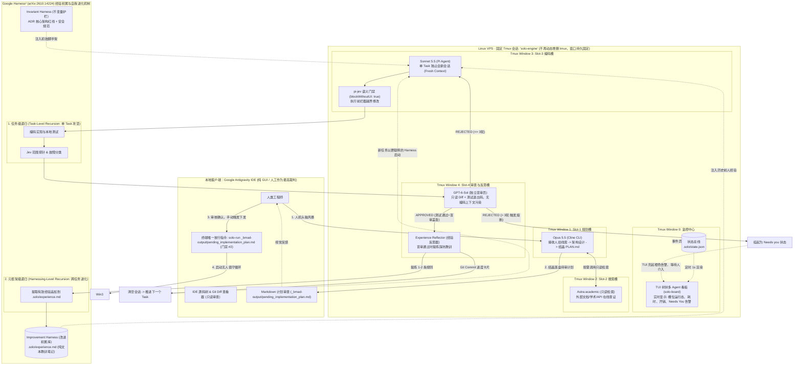

# BMRalph V5 架构：固定 Tmux 拓扑、Harness² 双层递归与物理归属规范

## 一、 架构全景图 (融合固定 Tmux 拓扑与 Harness² 双层递归)

---

## 二、 物理归属与职责分工矩阵 (各组件都在哪里？)

| 逻辑角色 | 物理载体 / 宿主 | 职责边界 | 数据与文件归属 | 人的使用方式 |
| :--- | :--- | :--- | :--- | :--- |
| **本地开发端** | 本地电脑 **Antigravity IDE** | **纯 GUI 审查与把关**：不跑后台长任务，不承担多 Agent 进程调度，杜绝 IDE 崩溃影响远端。 | 查看 Git Diff、阅读 `_bmad-output/pending_implementation_plan.md`。 | 人在图形界面看代码变动；审核完在集成终端敲一条下发命令。 |
| **监控看板中心** | VPS Tmux Session `solo-engine` **Window 0** (`board`) | **全景状态回显**：独立运行 `solo-board`，读取 `.solo/state.json` 刷新树状图，显示模型、耗时、成本与状态。 | `.solo/state.json`（单向只读读取，不写业务代码）。 | 随时 SSH 连入即可查看全局进度；本地 IDE 关掉后台依然实时刷新。 |
| **Slot-1 (规划)** | VPS Tmux Session `solo-engine` **Window 1** (`planner`) | **架构与规划**：由 Opus 5.5 (Cline CLI) 承载，负责需求三遍阅读、技术调研与生成待审计划。 | 产出 `_bmad-output/adrs/ADR-xxx.md` 与 `_bmad-output/pending_implementation_plan.md`。 | 前期人机交流的主要窗口。落盘后进入休眠，不占用 Token。 |
| **Slot-2 (搜索)** | VPS Tmux Session `solo-engine` **Window 2** (`search`) | **外部证据检索**：由 Astra:academic 承载，只读联网，绝不修改本地生产源码。 | 产出 `.solo/research/` 临时事实线索。 | 被 Slot-1 或 Slot-3 按需调用。 |
| **Slot-3 (编码)** | VPS Tmux Session `solo-engine` **Window 3** (`coder`) | **单 Task 攻坚 (Task-Level)**：Sonnet 5.5 (Pi Agent)，单任务全新上下文，pi-jev 阻断越界修改。 | 读写业务源码、运行本地单元测试。 | 全自动运行，完成一个 Task 立即物理销毁会话。 |
| **Slot-4 (审核与反思)** | VPS Tmux Session `solo-engine` **Window 4** (`reviewer`) | **独立盲审与经验反思 (Harness-Level)**：GPT-6-Sol 审查 Diff，通过时充当 Experience Reflector。 | 写入 Git Commit Trailer，追加 `.solo/experience.md`。 | 彻底隔离编码过程，充当客观的验收守门员。 |

---

## 三、 Google Harness² (arXiv:2610.14224) 启示与落地整改

### 1. 为什么此前会写出 1728 行冗余代码？
- **误区**：之前的实现把“经验沉淀”理解成了**软件工程里的数据库持久化**，由 Sonnet 5.5 手写了一套带事务锁、版本号、幂等消费的 `bmad_control_store.py`；
- **Harness² 的正解**：大模型不需要数据库！Harness² 的核心发现是——**以文本级脚手架（Textual Harness）的动态增修，代替模型权重微调。**

### 2. Harness² 在本架构中的落地三要素
1. **Invariant Harness (不变量护栏)**：
   - 固化在 `_bmad-output/adrs/` 中的架构红线（如“单 Task 预算 600s”、“严禁跳过测试退出码”），编码模型无权修改。
2. **Task-Level Recursion (任务级递归)**：
   - Slot-3 编码时，如果测试失败，在同一个 Task 内允许最大 3 轮自我修复；Jev 门禁实时探测修改范围是否超标。
3. **Improvement Harness (经验改进库)**：
   - 任务通过后，Slot-4 (GPT-6-Sol) 充当 **Experience Reflector**，将该任务踩过的坑（如“某接口参数不能传空字符串”）提炼为 1 句话，直接追加至 `.solo/experience.md`；
   - **下一个 Task 启动时，外层脚本自动将 `.solo/experience.md` 的最新内容拼装在 Prompt 开头！** Agent 在新窗口中天然拥有上一轮的智慧，彻底避免重复犯错。