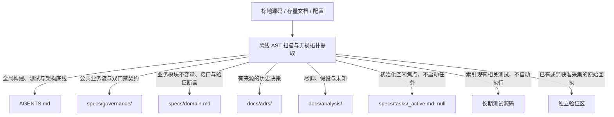

# BMAD-Solo 架构底座蓝图

本蓝图为 PROPOSED 架构草案，适配组件分类与契约抽象，不实施控制器、宿主激活或自动自修改。
业务不变量保持不变：单体 Plan–Act 循环、3+1 固定槽位、CS/SR 双门禁、真实证据纪律与无损蒸馏。

## 1. 跨 Agent 统一标准文档全景拓扑

“3+1”指三级稳定知识槽位加一个瞬态工作槽位，不是四个 Agent，也不是八组件的一对一目录复制。
宿主按实际发现与加载能力桥接；项目级宪法仍服从平台规则、当前用户授权及真实工具权限。

```text
<brownfield-project-root>/
├── AGENTS.md                         # Tier 1：项目最高宪法，<150 行，公共纪律与导航
├── specs/                            # Tier 2：按领域冷加载的当前契约
│   ├── governance/                   # Base 治理底座，索引及 01—05 模块
│   ├── <domain>.md                   # 业务不变量、接口、验证要求与决策引用
│   └── tasks/                        # 任务契约与独立生命周期
│       ├── _active.md                # 唯一焦点薄指针；初始 null，不复制进度
│       ├── TU-<task_id>.md            # 获准时实例化贡献契约
│       └── archive/                  # 全任务完成且获准后防覆盖归档
├── docs/                             # Tier 3：可追溯决策与尽调资产
│   ├── adrs/                         # 重要决策与状态，PROPOSED / ACCEPTED
│   └── analysis/                     # 事实、假设、限制与来源
├── tests/                            # 独立长期测试源码；保留棕地现有有效布局
├── verification/                     # 原始机械回执、审查材料与失败现场
└── .scratch/                         # +1：获准瞬态草稿，不提供执行级沙箱
```

测试源码和原始证据是支撑资产，不新增知识层级。瞬态草稿不作为历史任务唯一保存位置。
宿主桥接文件只引导阅读项目宪法，不复制治理正文；未核验加载前不声称无缝激活。
布局是目标契约，不授权迁移棕地现有文件、覆盖用户改动或退役旧消费者。

## 2. 槽位职责、生命周期与治理红线

| 槽位 | 应保存 | 禁止混入或自动执行 | 生命周期 |
|---|---|---|---|
| [`AGENTS.md`](../AGENTS.md) | 源码可追溯的构建、测试入口、架构底线与领域导航 | 历史流水、凭据、未经执行的通过断言 | 少于 150 行；全局契约变化时获准更新 |
| [`specs/governance/`](../specs/governance/) | 公共业务流、交接、双门禁与宿主适配契约 | 任务进度、宿主已加载或程序强制的无证声明 | 独立领域规范，按职责冷加载 |
| [`specs/`](../specs/)下的领域模块 | 不变量、接口、所有权、验证要求与 ADR 引用 | 全量源码、逐轮日志、未经接受的事实 | 按业务主题演进；预算不足拆分而不删义务 |
| [`specs/tasks/_active.md`](../specs/tasks/_active.md) | 当前唯一焦点的身份、实例、契约版本与定位 | 完整任务正文、第二份进度、历史绿灯 | 初始 null；启用或切换另获授权 |
| [`specs/tasks/`](../specs/tasks/) | 获准贡献契约、CS、KCP、SOD、依赖和验收 | 逐轮流水、自动恢复暂停任务 | 完整保存后复核源，获准才归档 |
| [`docs/adrs/`](adrs/)与[`docs/analysis/`](analysis/) | 决策、证据等级、适用条件、来源与限制 | 调试流水、伪造历史动机、自动转正 | 保留历史及来源；状态或结论更新须有授权 |
| [`tests/`](../tests/) | 长期相关回归与确定性断言 | 原始日志、探针响应、无关全库盲测 | 必需检查逐项通过，不按比例删测 |
| 目标验证区 | 当前候选原始回执、审查材料和失败现场 | 当成业务测试集，或未经授权删唯一证据 | 按保全契约留存，清理及归档另获授权 |
| 目标瞬态草稿区 | 获准的过程草稿与临时排查脚本 | 作为执行级隔离、身份认证或永久账本 | 按实际宿主忽略能力管理，不承诺保密 |

当前进度只使用已核验且覆盖本任务的控制器；否则使用平台任务记录并披露覆盖缺口。
状态卡只能是程序生成的只读视图；计划、ADR 和活动指针不镜像进度。
旧默认计划入口仍有消费者时保留；正规化布局不静默迁移或启用双权威入口。

## 3. 棕地项目知识蒸馏的标准 Mapping 实操指南

保持“从源码与存量资料提取事实，再按职责分流”的核心逻辑；目录归位不改变业务状态机或现有运行行为。
先保真后压缩，保留完整不变量、必要调用边、支持闭包、条件、否定、所有权、副作用及未知。



- 构建配置、依赖声明和存量说明提炼到[`AGENTS.md`](../AGENTS.md)：命令有来源；“存在／可用／已运行通过”分别陈述，不为凑三条命令而编造。
- 公共治理契约归[`specs/governance/`](../specs/governance/)；业务领域模块归[`specs/`](../specs/)，至少包含不变量、接口与验证断言，必要时附所有权、条件及 ADR 引用。
- 有文档或可审计来源支持的历史选择归[`docs/adrs/`](adrs/)；单凭源码结构不能推断当年的动机，未知与尽调归[`docs/analysis/`](analysis/)。候选 ADR 默认 PROPOSED。
- 初始化[`specs/tasks/_active.md`](../specs/tasks/_active.md)为空闲薄指针，不生成虚构任务或重置既有焦点；第一项实施另获授权后才实例化贡献契约。
- 边缘用例先关联现有测试与断言；新测试、网络探针、业务验证及生产迁移须另有相应授权。原始回执保留独立来源，不因整理目录删除。

操作细则由[`brownfield-distill-governance.md`](../bmad-suite-v4/skills/bmad/references/procedures/brownfield-distill-governance.md)承载；初始化不默认执行真实棕地样本。

## 4. 3+1 槽位与 Google HARNES² 八组件标准化映射

依据本地[`google-harness2.md`](paper-analysis/google-harness2.md:855)的 Table 5 与[`google-harness2.md`](paper-analysis/google-harness2.md:66)的 Figure 2；未独立核验出版标识或宿主实现。
这是职责适配矩阵，不照搬论文的文件名、每次调用加载策略或自动递归执行。

| 组件 | 3+1 归属与本项目承载 | 激活与约束 |
|---|---|---|
| C1 System Prompt | Tier 1：[`AGENTS.md`](../AGENTS.md)提供公共导航；[`SKILL.md`](../bmad-suite-v4/skills/bmad/SKILL.md:22)承载 Plan–Act 路由 | 宿主实际加载时生效；明确需求直接消费，不模拟多 Agent 会议 |
| C2 Guardrails | Tier 1 底线 + Tier 2：[`specs/governance/`](../specs/governance/)与[`bmad-constitution.md`](../bmad-suite-v4/rules/bmad-constitution.md) | 平台、权限、来源、CS/SR 与副作用边界不可被子实例放宽；提示词不等于程序强制 |
| C3 Memory | Tier 2 当前领域知识 + Tier 3：[`docs/adrs/`](adrs/)与[`docs/analysis/`](analysis/) | 按职责冷加载；只吸收获准且有证据的稳定知识，不继承任务历史绿灯 |
| C4 Tool Guidance | Tier 1 导航 + Tier 2 验证契约；[`SKILL.md`](../bmad-suite-v4/skills/bmad/SKILL.md:129)及真实工具声明 | 实际工具参数、审批与覆盖决定能力，不虚构 MCP 或终端入口 |
| C5 Subagents | Tier 2：[`specs/governance/01-plan-act-role-embedding.md`](../specs/governance/01-plan-act-role-embedding.md:78)的职责切片与任务契约 | 默认一个 Plan–Act 实例；独立上下文及多实例调度是另获准扩展，不证明 SR 独立身份 |
| C6 Skills | Tier 2 的操作能力入口：[`SKILL.md`](../bmad-suite-v4/skills/bmad/SKILL.md:1)与按需规程 | 本次新增规程按 ops 意图加载；技能调用不增加扫描、写入或外发授权 |
| C7 Scripts | 执行支撑 + 原始验证证据；[`scripts/`](../scripts/)及获准草稿脚本 | 确定性离线能力须核验版本和覆盖；串行、限时、前台同步、封闭输入、原生文件读写 |
| C8 Middleware（论文组件名 Plugin） | 贯穿各层的工具环路控制；[`specs/governance/04-kcp-sod-gates.md`](../specs/governance/04-kcp-sod-gates.md:200)定义门禁契约 | 只有真实实现并覆盖操作的控制器可称强制；当前映射不安装插件，不声称已拦截旁路 |

+1 瞬态槽位可承载获准候选与对照草稿，但不是 C3 永久记忆或 C8 控制器的替代。
论文的候选行为对照只用于定位改善与回归，不能代替业务正确性、机械证据或独立 SR。
任务级候选不得修改 Base 安全底线；跨任务经验入库仍须相应授权，不开启自动生产自修改。

## 5. 宪法底座即 Base 类与 AutoSwarm 扩展接口

Base 类是文档契约抽象：[`AGENTS.md`](../AGENTS.md) + [`specs/governance/`](../specs/governance/)，不是已实现的运行时类或新调度框架。
它提供共同前置条件、Plan–Act 生命周期、3+1 路由、数据交接、CS/SR 与证据失效规则。
领域实例继承 Base 契约，仅补充业务不变量、接口、验证和当前授权；“继承”不授予工具权限。

- 实例绑定：父客户目标、贡献任务、实例、契约版本、来源及授权；未知身份保持 null，不挪用历史任务。
- 输入接口：消费当前已接受的上游结果、领域契约及必要支持闭包；未接受结果仅供诊断。
- 输出接口：交付候选定位、机械回执、限制与下游用途；与独立 SR 一起判定接受，生产者不能自批。
- 验证接口：优先真实覆盖的类型化入口；没有覆盖时引用平台实际回执，披露控制器及独立性缺口。
- 依赖释放接口：CS=PASS 且 SR=APPROVED、版本适用并满足父目标及权限，才释放指定边；失败或终止不等于接受。
- 隔离接口：每个实例明确候选所有权、写入范围与审查身份；共享状态有单一权威，各实例不建立镜像账本。

业务流 DAG 的节点是贡献任务，不是强制“一节点一 Agent”；单体实例通过继承 Base 契约嵌入节点并承担生产、修正及受限交接。
未来 AutoSwarm 可将多个继承同一 Base 的实例分配给多个节点；依据[`autoswarm.md`](Ralph-Wiggum-Loop/autoswarm.md:153)保留贡献、所有权、依赖与监督接口。
这只是扩展接缝，不修改默认单体主循环，不启动多 Agent，不取消同会话单焦点或串行终端纪律。

## 6. 本次草案的交付与非保证

一致性以[`specs/governance/00-governance-index.md`](../specs/governance/00-governance-index.md)及 01—05 模块为准；保真、软预算和分片沿用已接受的[`ADR-20261028-adaptive-backpressure-and-lossless-distillation.md`](adrs/ADR-20261028-adaptive-backpressure-and-lossless-distillation.md:45)。
本次只刷新蓝图、结晶规程与注册套件路由；不迁移旧任务、修改事实基线、转正新提案、归档、部署或运行真实样本。
静态文档自检不证明引擎、C8、宿主自动触发、模型完整消费或独立 SR 已通过。
