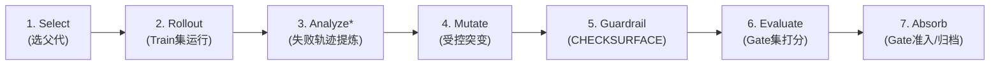

# RSIHub 架构解构与 Agent 宪法演化研究体系 (RSIHub & 6 Core Papers)

- **主文献来源**: *RSIHub: A Composable Framework for Agent-Evolution Methods*
- **arXiv 标识**: [arXiv:2610.32253v1 [cs.AI]](https://arxiv.org/abs/2610.32253)
- **开源代码**: [https://github.com/simple-agent-lab/RSIHub](https://github.com/simple-agent-lab/RSIHub)
- **文档定位**: `docs/references/RSIhub-agent-paper.md`
- **核心主题**: 智能体自演化架构（策略与评估彻底解耦）、防作弊三阶隔离、以及自动提炼与演化项目宪法（`AGENTS.md`）的 6 篇前沿一手顶会/arXiv 支撑文献。

---

## 1. RSIHub 论文核心突破与实验真相

### 1.1 核心主张与反直觉实验事实 (Hard Truths)
1. **策略与评估彻底解耦 (Policy-Runtime Decoupling)**:
   - 现存演化方法（AHE, Hyperagents, A-Evolve, GEPA）复现困难与虚假提升的根源在于：演化策略与评估基础设施紧耦合。
   - RSIHub 将测量与记录控制在框架层（仅占端到端耗时中位数的 0.02%），所有演化策略通过声明式配方（47–61 行 YAML）与可复用算子实现。
2. **无单一最优演化算法 (No Free Lunch)**:
   - 没有任何一种算法在不同基座 Agent、基准测试和数据划分中全面占优。
   - 例如：Hyperagents 在 MiniSWE + Terminal Bench 2 提升 +13.5%，但在 Codex + $\tau^3$ Banking 上大幅落后于 AHE (+9.3%) 与 GEPA (+8.3%)。
3. **总体指标提升往往掩盖盲测集退化 (Held-out Degradation)**:
   - 多个配置出现总分上涨，但保留盲测集（Sealed Split）明显下跌（最高跌 -4.1%）。
   - 自我修改（Self-Modifying）系统若无受保护评估边界，极易通过修改测试条件或对训练集过拟合来“作弊刷分”。
4. **LLM Agent 评估具备显著的固有执行方差**:
   - 不演化的纯种子 Agent，在相同环境下的两次直接执行不一致率达 12.0%–18.9%（D-D disagreement）。
   - 单次提升 < 3% 极大概率是环境或采样噪声，必须依靠多次评估或严格的盲测集验证。

### 1.2 七阶段生命周期槽位与三阶隔离规范



- **数据三阶隔离**:
  - `Train 集`: 仅用于 Rollout 生成轨迹，提炼失败案例供 Mutate 参考。
  - `Gate 集`: 仅用于 Evaluate 评估子代打分，Gate 算子据此决定是否准入为 Parent。
  - `Sealed 集`: 完全脱离演化环路，作为终考卷（Anchor），定期校验真实泛化能力。
- **表面边界拦截 (CHECKSURFACE)**:
  - 强制通过 Git Tree Diff 校验可变表面（`surface.include`）。越界修改在进入评估前立即被拒绝并归档。
- **不可伪造的评测契约 (Evaluation Identity Contract)**:
  - 复合哈希 `contract_id` 强绑定：代码 Commit + 评估器摘要 + 数据集指纹 + 采样种子 + 模型版本与参数 + 框架版本。

---

## 2. 映射落地：AGENTS.md 自动蒸馏与演化的 6 篇核心一手文献

将 RSIHub 的演化闭环落地于“自动提炼与维护代码库宪法（`AGENTS.md`）”，学术界在 2025~2026 年形成了 6 篇核心支撑文献：

### 文献 1: Agentic Context Engineering (ACE)
- **出处**: *Agentic Context Engineering: Evolving Contexts for Self-Improving Language Models* (Zhang et al., Stanford & SambaNova, ICLR 2026)
- **核心对象**: 动态演化 Playbook / Context 文件的多角色自改进框架。
- **关键发现**: 提出 **Generator（执行） $\rightarrow$ Reflector（从轨迹提炼经验） $\rightarrow$ Curator（增量合并、去重、淘汰失效规则）** 三角色分离架构。在 AppWorld 上比基线提升 +10.6%~17.1%，大幅降低适应延迟。
- **工程指导**: 绝不让写代码的 Generator 角色修改 `AGENTS.md`；必须由独立的 Reflector + Curator 进程做增量 Delta 更新与语义去重。

### 文献 2: Configuration Smells in AGENTS.md Files
- **出处**: *Configuration Smells in AGENTS.md Files* (arXiv:2606.15828v2, 2026年6月)
- **核心对象**: 对 100 个开源项目 `AGENTS.md` / `CLAUDE.md` 的实证分析。
- **关键发现**: 揭示 207 例配置坏味道：**Lint Leakage（62%，把 Linter/编译器本就能拦截的规则写进文档白白浪费 Token）**、**Context Bloat（42%，上下文膨胀）**、**Skill Leakage（35%）**。指令冲突会使膨胀概率增加 83%。
- **工程指导**: 强类型与编译器能拦住的（如语法、基础格式），严禁写入 `AGENTS.md`！`AGENTS.md` 只保留工具链查不出的架构边界、反过度设计与隐式调用契约。

### 文献 3: Evaluating AGENTS.md: Are Repository-Level Context Files Helpful?
- **出处**: *Evaluating AGENTS.md: Are Repository-Level Context Files Helpful for Coding Agents?* (Gloaguen et al., arXiv:2602.11988v2, 2026年6月)
- **核心对象**: 评估手动与自动生成的 `AGENTS.md` 对 Coding Agent 的真实影响。
- **关键发现**: Agent 会严格服从上下文文件，但**冗长、非必要的指令反而让任务通过率下降**；唯有极简（Minimal）、只写核心约束的文件才具备正向增益。
- **工程指导**: 蒸馏引擎不能做“全量文档总结器”，必须是“最小承重约束提炼器（Minimal Load-Bearing Extractor）”。

### 文献 4: Toward an Evidence-Based Template for Agent Instruction Files
- **出处**: *Toward an Evidence-Based Template for Agent Instruction Files* (Shanto et al., arXiv:2611.02383v1, 2026年11月最新)
- **核心对象**: `AGENTS.md` 与 `CLAUDE.md` 的采用、一致性与自动生成标准。
- **关键发现**: 仅靠结构完整度（Structural Completeness）不足以评估有效性，提出了基于实证的标准化模板（AGIT-Template）。
- **工程指导**: 必须使用结构化模板：Commands（单点检查命令）、Architecture Invariants（架构不变量）、Anti-Overdesign（反过度设计条目）、Routing Table（目录路由表）。

### 文献 5: Agentic Harness Engineering (AHE)
- **出处**: *Agentic Harness Engineering: Observability-Driven Automatic Evolution* (Lin et al., arXiv:2604.25850, 2026年4月)
- **核心对象**: 可观测性驱动的编码 Agent 脚手架与提示词自动演化。
- **关键发现**: 唯有通过提取真实可观测性执行证据（Observability Evidence：报错栈、越界行为、超时轨迹）才能驱动高质量演化。
- **工程指导**: 结合强类型与属性模糊测试（PBT / Fuzzing），测试撞出的最小反例（Counterexample）就是提炼负向约束（Never do X）的最佳证据源。

### 文献 6: On the Impact of AGENTS.md Files on Coding Agents / Agent READMEs
- **出处**: *On the Impact of AGENTS.md Files on the Efficiency of AI Coding Agents* (arXiv:2511.12884, 2026年5月)
- **核心对象**: 量化测量 `AGENTS.md` 对执行耗时与 Token 消耗的影响。
- **关键发现**: 优质、精炼的 `AGENTS.md` 能使 Agent 中位运行时间降低 28.64%，输出 Token 消耗减少 16.58%，核心收益来自消除了盲目的全仓文件搜索（Repo Exploration）。
- **工程指导**: 强化“目录分级路由（Routing Table）”与“精准单模块测试命令”，避免长上下文拖慢推理。

---

## 3. 工程拓扑：Tmux 4+1 多角色物理隔离架构

为了彻底消灭多轮对话中修改 `AGENTS.md` 导致的 **Prompt Caching 击穿** 与 **上下文污染**，设计了 Tmux 进程隔离拓扑：

```
+-----------------------------------------------------------------------------------+
| Tmux Pane 0: [Orchestrator / Architect] (主控状态机 - 维护进度与 3 轮背压计数器)   |
+-----------------------------------------------------------------------------------+
       | (1. 派发前置分析)                 | (2. 派发编码契约)            | (4. 结项/熔断单次唤醒)
       v                                   v                              v
+-----------------------------+  +-----------------------------+  +-----------------------------+
| Pane 1: [Scout / Collector] |  | Pane 2: [Coder / Builder]   |  | Pane 4: [Curator / Distiller|
| (代码考古/接口快照)        |  | (纯净编码 - 窄腰高缓存)     |  | (宪法策展 - 独占蒸馏 MCP)   |
| - 扫 AST, git log -S        |  | - 权限: 仅写业务源码        |  | - 权限: 仅改 AGENTS.md      |
| - 输出: 只读 Interface 快照 |  | - 禁区: 禁碰测试与宪法      |  | - 触发: 结项单次触发 (1 次) |
+-----------------------------+  | - 缓存: 100% 命中前缀       |  | - 门禁: 12k 字符棘轮 + 去Lint|
                                 +-----------------------------+  +-----------------------------+
                                               | (3a. 提交代码)
                                               v
                                 +-----------------------------+
                                 | Pane 3: [Breaker / Verifier]|
                                 | (强类型 + PBT Fuzzing 背压) |
                                 | - Level 1: 静态类型与 Linter|
                                 | - Level 2: 单模块行为单测   |
                                 | - Level 3: 属性模糊测试     |
                                 | - 输出: 结构化失败证据      |
                                 +-----------------------------+
                                               | (3b. 错误精确打回，最多 3 轮)
                                               +-----> 回到 Pane 2 或熔断回 Pane 0
```
