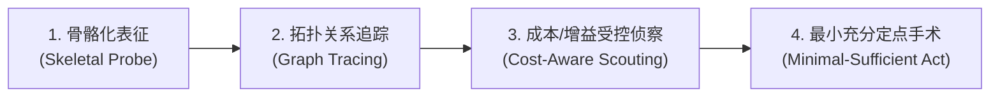

# Sparks of Weight-Space Programming (Astra 权重空间编程) 理论参考与架构解构

- **文献来源**: MIT CSAIL 研究博客 (*Sparks of Weight-Space Programming*)
- **作者团队**: Rikiya Takehi, Jayden Teoh, Alex Zhang, Omar Khattab (MIT CSAIL)
- **在线地址**: [https://rikiyat.github.io/blog/weight-space-programming/](https://rikiyat.github.io/blog/weight-space-programming/)
- **前置会话归档**: `docs/references/astra-weight.md`
- **核心主题**: 前沿闭源大模型（GPT-6 Astra）对开源模型连续权重空间的直接探针分析、无梯度缺陷修复与定点手术。

---

## 1. 核心突破与范式转变 (Paradigm Shift)

### 1.1 传统 AI Coding 与 Weight-Space Programming 的本质区别

| 维度 | 传统 AI Coding / 自动微调 (SFT / RL) | Weight-Space Programming (权重空间编程) |
| :--- | :--- | :--- |
| **操作对象** | 符号代码（Python 训练脚本、Loss 函数、超参数） | 连续浮点权重数值本身（直接阅读 $W_l, b_l$，或定点修改权重张量） |
| **数值决策者** | 梯度下降优化器（SGD / Adam / Muon），经成千上万步反向传播间接算出 | **LLM 推理过程直接决定**（无梯度下降、无训练循环、零环境交互手写/微调数值） |
| **可解释机制** | 黑盒试错（改代码/改数据 $\rightarrow$ 跑训练 $\rightarrow$ 观察 Loss 是否下降） | **白盒机械可解释性（Mechanistic Interpretability）闭环**：通过张量谱推导网络行为 $\rightarrow$ 定点外科手术 |
| **类比** | 给小模型一份新教材和考纲，让小模型刷题训练 | **AI 当脑外科医生**，直视神经网络突触连接强度，手术刀微调关键权重 |

### 1.2 关键实验事实 (Supported Facts)

1. **零工具盲猜游戏 (Experiment 1)**:
   - 输入相同架构（MLP $500 \rightarrow 32 \rightarrow 32 \rightarrow 5$，共 17,253 个连续权重）的纯文本浮点数。
   - Astra 仅凭权重在 $10 \times 10$ 网格上的空间分布（如识别出底部第 8 行强权重对应挡板、第 1~3 行对应砖块），以 99% 置信度准确识别出 Breakout（打砖块）、Pong、Pac-Man、Freeway 四款游戏。
2. **从零手写策略网络**:
   - Astra 零样本直接手写游戏策略网络权重，其表现超越 1 亿步 PPO 强化学习训练的效果。
3. **开源小模型无梯度外科手术 (Experiment 8)**:
   - 针对开源小模型 Qwen3.5-0.8B（8 亿参数），Astra 挂载 Python REPL 探针（禁用 `backward()` 和训练循环）。
   - 通过统计量、SVD 奇异值分解和激活分布排查，定位出导致推理死循环（Reasoning Loops）的注意力头与投影层。
   - **仅修改了 0.016% 的权重**，使 Qwen3.5-0.8B 的 MATH-500 基准准确率从 **7.9% 暴涨至 48.1%**，IFEval 指令遵循指标提升 3 倍。

---

## 2. 通用方法论：Probe-Map-Prune-Act 范式

Astra 将“面对超大规模复杂系统（8 亿浮点数）无法全量塞入上下文”的物理限制，抽象为四步闭环：

1. **骨骼化表征 (Skeletal Probe)**:
   - 不把数亿浮点数转为纯文本塞进 Prompt。
   - 使用确定性 Python 脚本计算各层张量的范数、均值、奇异值谱（SVD）作为轻量元数据。
2. **拓扑关系追踪 (Topological Graph Tracing)**:
   - 沿着 Transformer 残差流（Residual Stream）、注意力头（Attention Heads）与 MLP 投射追踪特征因果传播路径。
3. **受控侦察 (Cost-Aware Scouting)**:
   - 基于假设检验定位异常吸引子所在的特定层与奇异向量方向，避免全局重新微调带来的算力爆炸与灾难性遗忘。
4. **最小充分定点手术 (Minimal-Sufficient Action)**:
   - 仅在内存中针对 0.016% 的目标矩阵做正交投影消除或缩放，一步修复模型缺陷。

---

## 3. 与 FastCode (arXiv:2603.01012v2) 及代码库分析的范式同构性

| 阶段 | 模型权重空间 (Astra) | 棕地项目源码空间 (FastCode / solo-distill-mcp) |
| :--- | :--- | :--- |
| **1. 骨骼化表征** | 计算权重张量范数、奇异值谱（SVD）作为元数据 | AST 提取 File/Class/Function 签名、Docstring、行数作为元数据 |
| **2. 拓扑关系图** | 沿残差流与注意力头建立特征传播路径 | 建立三层有向图 $G = \{G_{dep}, G_{inh}, G_{call}\}$，追踪跨模块依赖 |
| **3. 成本感知侦察** | 假设检验定位异常层，监控扰动增益 | 伪代码锚点 + 轻量搜索工具，监控信息增益率 $IGR_t$，置信度达标早停 |
| **4. 最小充分操作** | 仅覆盖 0.016% 目标权重，单步完成模型修复 | 按行数预算 $B$ 一次性只加载核心代码块正文，单步完成推理/补丁/蒸馏 |

---

## 4. Prompt Caching 与认知防幻觉机制解构

### 4.1 双层机制界定
1. **物理基础设施层 (KV Cache 前缀复用)**:
   - 保持 Prompt 前缀不变，复用已计算好的 Key-Value 张量，降低成本与延迟。
   - *脏读隐患*: 当目标系统（代码或权重）已修改，若前缀仍引用旧探针结果，产生 Stale Cache。
2. **认知推理层 (Context Anchoring / 确认偏误自激)**:
   - 在多轮 ReAct Agent 中，模型早期的未证实猜想（`Thought_1`）被锁在对话历史中。在因果注意力作用下，后续生成极度迎合最初假设，形成严重的“回音室幻觉”。

### 4.2 Astra 的客观性背压策略
- **符号执行外置 (Execution-Grounded Probing)**: 大模型不靠主观脑补，而是在 Python Kernel 中运行确定性数学探针，真实计算数值直接证伪（Falsify）错误猜想。
- **终局冲洗 (Clean State Verification)**: 最终修改只生成独立脚本，在干净状态（Clean State）下重新跑基准评测，彻底切断多轮探索历史对评估的污染。
